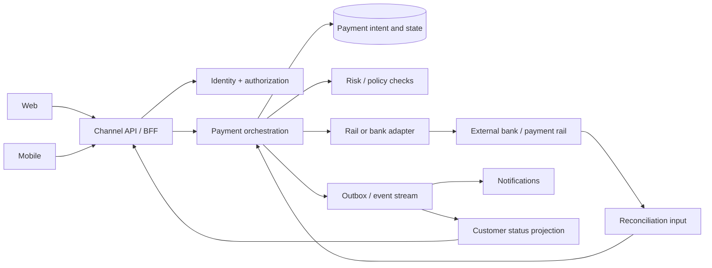

# American Express solution architect interview prep: cross-platform projects

## 1. Practice case A: pay a card bill from web and mobile

**Fictional prompt:** Card Members should be able to schedule a card-bill payment from both web and mobile, receive
consistent status, and avoid duplicate payments. The payment source may involve an external bank or payment rail. Design
the integration.

### Clarifying questions

- Is this a one-time payment, scheduled payment, or both? Can the customer cancel or edit it?
- What is the authoritative distinction between **accepted**, **submitted**, **settled**, **failed**, and **reversed**?
- Which system owns the ledger and customer-visible balance? What consistency is required for the UI?
- Which rails and geographies are in scope? What are cutoffs, weekends, and holidays?
- What are expected and peak request rates, availability targets, and downstream limits?
- What must be retained for audit and customer service, and for how long?

### Candidate architecture

**Explain the boundaries:** The channel API handles channel-appropriate responses; the payment service owns the
transaction state machine; an adapter isolates rail-specific details; the ledger or other system of record remains
authoritative for posted financial position. This is an interview design, not a claim about American Express systems.

### Critical design choices

| Choice               | Interview-quality answer                                                                                                                                                                                                        |
|----------------------|---------------------------------------------------------------------------------------------------------------------------------------------------------------------------------------------------------------------------------|
| Duplicate prevention | Require a client-generated idempotency key scoped to the customer and operation. Store request fingerprint and outcome atomically; replay returns the same operation ID. Do not promise exactly-once delivery across a network. |
| Timeout ambiguity    | If submission times out, mark the operation **pending verification**, query by partner reference, and reconcile before any retry that could send money twice.                                                                   |
| State model          | Define allowed transitions and distinguish customer request acceptance from actual settlement. The UI must not say “paid” when only “submitted” is known.                                                                       |
| Async updates        | Publish state changes via an outbox pattern; make consumers idempotent. Use polling or push notifications as appropriate, with a durable status endpoint as fallback.                                                           |
| Security             | Use least-privilege service access, strong customer authentication where required, encryption, tokenization or data minimization, and protected secrets. Confirm applicable policies with security and compliance teams.        |
| Operations           | Track request success, partner acceptance, settlement lag, reconciliation breaks, duplicate suppression, p95/p99 latency, and customer-visible status lag.                                                                      |
| Release              | Start with a narrow pilot and feature flag; test cutoffs, reversals, partner failures, and rollback behavior.                                                                                                                   |

### A strong 90-second design summary

> I would give web and mobile a shared payment API so both channels use the same server-side validation and transaction
> state machine. The service creates a durable payment intent before calling a rail adapter. Every submission has a scoped
> idempotency key and a partner reference. A timeout is an unknown outcome, so I would verify and reconcile before
> retrying. The customer sees accurate states such as scheduled, processing, settled, or failed; the ledger or posting
> system remains the authority for financial position. I would add end-to-end tracing, reconciliation alerts, contract
> tests with the partner, and a staged rollout. The main tradeoff is a little more orchestration complexity in exchange
> for consistent behavior and lower duplicate-payment risk across channels.

### Follow-up probes to practice

1. The customer taps “Pay” twice and switches from mobile to web. What happens?
2. The rail accepts the transaction, but the response is lost. What state is shown and who resolves it?
3. A payment is reversed three days later. How do events, UI, and customer service stay consistent?
4. A downstream system can handle only one tenth of projected peak traffic. Where do you apply backpressure?
5. Product wants “instant success” messaging. How do you explain why state wording matters?

## 2. Practice case B: one servicing capability across several channels

**Fictional prompt:** A Card Member can dispute a transaction through web, mobile, and an assisted-service channel. Each
channel has different UI needs, but the dispute process and evidence requirements must stay consistent.

**Design answer:** Put eligibility rules, case creation, evidence requirements, and case state in a shared domain
service. Give channels a stable API and channel-specific composition layer. Use a common case ID, explicit versioned
schemas, and an event stream for status changes. Keep sensitive evidence in controlled storage with access rules and
retention defined by the business and legal teams. Support assisted-service handoff through the same case record instead
of creating a parallel process. Measure cross-channel completion, handoff failures, status freshness, and operational
backlog.

**Tradeoff to discuss:** A single shared service improves consistency but can become a bottleneck. Design clear domain
ownership, scalable reads, and a careful change process so teams can ship channel experiences independently.

## 3. Practice case C: modernize a legacy platform safely

**Fictional prompt:** A legacy service handles a core capability used by multiple products. The business wants faster
delivery without a risky big-bang replacement.

**Answer outline:** Map current consumers and contracts. Put a stable facade in front of the legacy capability. Choose a
narrow business slice with clear ownership. Run old and new paths in parallel where appropriate, compare outputs, and
define reconciliation tolerances. Move reads first only if consistency and business semantics permit; then move writes
behind a feature flag with an explicit rollback plan. Maintain compatibility or version contracts during migration.
Track latency, correctness, incident rate, and cost before retiring old components. Avoid claiming a “strangler”
migration is always safe for financial writes; explain where dual-write risk requires a different strategy.

## 7. Technical questions and what a strong answer contains

| Question                                     | Key points to cover                                                                                                                                                                           |
|----------------------------------------------|-----------------------------------------------------------------------------------------------------------------------------------------------------------------------------------------------|
| How do you define service boundaries?        | Business capability, data ownership, change cadence, transaction consistency, team ownership, and operational blast radius.                                                                   |
| REST API or event?                           | Synchronous request when caller needs a decision now; event when state changes need durable fan-out. Define ordering, replay, deduplication, and schema evolution.                            |
| How do you version an API?                   | Prefer additive changes; contract tests; deprecation window; explicit migration plan; avoid silent semantic changes.                                                                          |
| How do you handle partial failure?           | Timeouts, retries with bounded backoff, circuit breaking, idempotency, compensation or reconciliation, and clear customer state.                                                              |
| How do you design for resiliency?            | SLOs, failure domains, capacity, rate limits, isolation, recovery objectives, runbooks, and regular failure tests.                                                                            |
| How do you secure cross-platform data flows? | Data classification, least privilege, authorization at each boundary, encryption, key management, logging without sensitive payloads, and threat modeling.                                    |
| How do you choose a database?                | Query patterns, consistency, transaction semantics, scale, retention, operational maturity, and recovery.                                                                                     |
| How do you prevent platform coupling?        | Stable contracts, anti-corruption adapters, domain ownership, consumer-driven tests, and independent deployment.                                                                              |
| How do you review a design?                  | Compare it with business requirements and platform roadmap; inspect failure paths, data ownership, performance evidence, controls, and rollout plan. Record the decision and remaining risks. |
| What if teams disagree?                      | Surface the shared goal and constraints, document alternatives and evidence, run a focused experiment if needed, and make the decision at the right ownership level.                          |
| How do you diagnose a major outage?          | Establish customer impact, stabilize, follow traces and state transitions, coordinate owners, avoid unsafe retries, communicate status, then perform root-cause and prevention work.          |
| How do you balance speed with governance?    | Reusable standards and automated checks for routine decisions; deeper review for high-risk changes; time-box decisions and record exceptions.                                                 |
