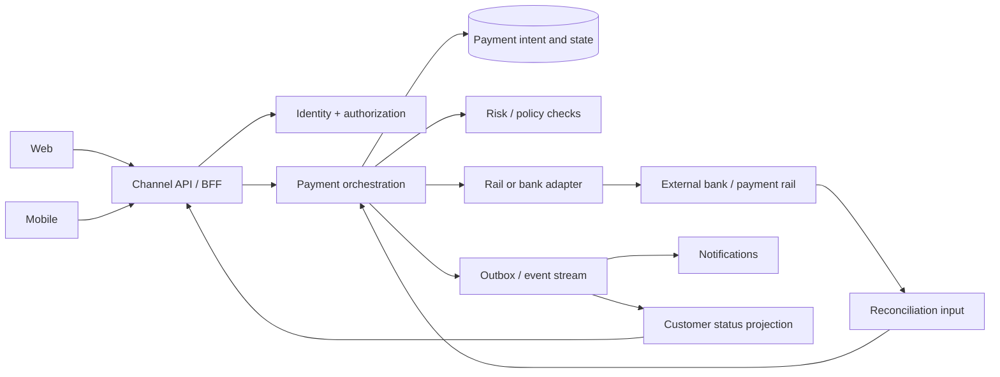

# American Express solution architect interview prep: cross-platform projects

**Prepared October 27, 2026.** This guide uses public American Express material and fictional practice cases. It does not use or assume anything from your résumé. The [Sr Solutions Architect II – Enterprise Architecture posting](https://careers.americanexpress.com/en/sites/CX_1/job/26014614/) is a useful role proxy; confirm the scope of your own interview with the recruiter.

## 1. What to be ready to demonstrate

The public posting emphasizes platform roadmaps and blueprints, cross-platform integration, performance and efficiency, hands-on design and code reviews, API strategy, partnership with business and data architects, architectural governance, mentoring, and outage diagnosis. It also mentions mobile and web initiatives and bill payment and money movement domain expertise. [Source: American Express role posting](https://careers.americanexpress.com/en/sites/CX_1/job/26014614/)

Translate those requirements into five interview themes:

| Theme | Show the interviewer |
|---|---|
| Business to architecture | Start with customer outcome, transaction semantics, constraints, and measurable success. |
| Platform boundaries | Define ownership of APIs, data, state, and policy across web, mobile, shared services, and external partners. |
| Trust and reliability | Cover authorization, privacy, idempotency, retries, reconciliation, observability, recovery, and audit evidence. |
| Delivery and governance | Explain options, tradeoffs, decisions, review checkpoints, migration, and how teams can move independently. |
| Technical leadership | Demonstrate hands-on review, influence without direct authority, coaching, and incident ownership. |

American Express describes its engineering and architecture work as building stable, secure systems, and lists API design, cloud, data security, disaster recovery, reliability, and scalability among relevant skills. [Source: American Express Technology Careers](https://www.americanexpress.com/en-us/careers/career-areas/technology/)

## 2. A reusable opening answer

**“How do you approach a cross-platform project?”**

> I begin with the business capability and the customer journey, then identify the systems that own each decision and piece of data. I make the transaction states and nonfunctional requirements explicit: latency, availability, security, auditability, and recovery. I agree on versioned API and event contracts with each platform team, including failure behavior and ownership. I compare design options against the platform roadmap, document the tradeoffs, and validate the riskiest assumptions with a thin end-to-end slice. Before broad rollout, I require contract tests, operational dashboards, reconciliation, and a rollback path. I measure whether the solution improved the customer outcome and reduced operational risk.

Use this as a structure, not a script. Replace generic language with your own verified examples when answering experience questions.

## 3. The whiteboard method: 10 steps in 25 minutes

1. **Clarify the journey:** Who is the user? What action do they take? What does success look like to them?
2. **Name the business invariant:** For money movement, define what must never happen, such as an unintended duplicate submission.
3. **Bound the system:** Draw channels, domain services, systems of record, external rails or partners, and operations.
4. **State assumptions:** Traffic, peak load, geographic scope, availability target, latency budget, retention, and data classification. Ask for missing numbers rather than inventing them.
5. **Choose ownership:** Identify the single owner of each state transition and the source of truth for each data field.
6. **Define contracts:** Request/response schema, versioning, idempotency key, authentication and authorization, timeouts, error codes, and events.
7. **Walk the happy path:** Trace one request from channel to final confirmed outcome.
8. **Walk failure paths:** Duplicate request, timeout after submission, delayed partner response, downstream outage, stale read, and partial rollout.
9. **Prove operability:** Correlation IDs, metrics, tracing, alerts, reconciliation, runbooks, recovery objectives, and audit trail.
10. **Deliver incrementally:** Contract tests, test environment, controlled launch, rollback, and success measures.

**Say your tradeoff aloud.** For example: “I would keep payment orchestration server-side so channels share the same state machine; I would still allow channel-specific presentation and accessibility behavior.”

## 4. Practice case A: pay a card bill from web and mobile

**Fictional prompt:** Card Members should be able to schedule a card-bill payment from both web and mobile, receive consistent status, and avoid duplicate payments. The payment source may involve an external bank or payment rail. Design the integration.

### Clarifying questions

- Is this a one-time payment, scheduled payment, or both? Can the customer cancel or edit it?
- What is the authoritative distinction between **accepted**, **submitted**, **settled**, **failed**, and **reversed**?
- Which system owns the ledger and customer-visible balance? What consistency is required for the UI?
- Which rails and geographies are in scope? What are cutoffs, weekends, and holidays?
- What are expected and peak request rates, availability targets, and downstream limits?
- What must be retained for audit and customer service, and for how long?

### Candidate architecture

**Explain the boundaries:** The channel API handles channel-appropriate responses; the payment service owns the transaction state machine; an adapter isolates rail-specific details; the ledger or other system of record remains authoritative for posted financial position. This is an interview design, not a claim about American Express systems.

### Critical design choices

| Choice | Interview-quality answer |
|---|---|
| Duplicate prevention | Require a client-generated idempotency key scoped to the customer and operation. Store request fingerprint and outcome atomically; replay returns the same operation ID. Do not promise exactly-once delivery across a network. |
| Timeout ambiguity | If submission times out, mark the operation **pending verification**, query by partner reference, and reconcile before any retry that could send money twice. |
| State model | Define allowed transitions and distinguish customer request acceptance from actual settlement. The UI must not say “paid” when only “submitted” is known. |
| Async updates | Publish state changes via an outbox pattern; make consumers idempotent. Use polling or push notifications as appropriate, with a durable status endpoint as fallback. |
| Security | Use least-privilege service access, strong customer authentication where required, encryption, tokenization or data minimization, and protected secrets. Confirm applicable policies with security and compliance teams. |
| Operations | Track request success, partner acceptance, settlement lag, reconciliation breaks, duplicate suppression, p95/p99 latency, and customer-visible status lag. |
| Release | Start with a narrow pilot and feature flag; test cutoffs, reversals, partner failures, and rollback behavior. |

### A strong 90-second design summary

> I would give web and mobile a shared payment API so both channels use the same server-side validation and transaction state machine. The service creates a durable payment intent before calling a rail adapter. Every submission has a scoped idempotency key and a partner reference. A timeout is an unknown outcome, so I would verify and reconcile before retrying. The customer sees accurate states such as scheduled, processing, settled, or failed; the ledger or posting system remains the authority for financial position. I would add end-to-end tracing, reconciliation alerts, contract tests with the partner, and a staged rollout. The main tradeoff is a little more orchestration complexity in exchange for consistent behavior and lower duplicate-payment risk across channels.

### Follow-up probes to practice

1. The customer taps “Pay” twice and switches from mobile to web. What happens?
2. The rail accepts the transaction, but the response is lost. What state is shown and who resolves it?
3. A payment is reversed three days later. How do events, UI, and customer service stay consistent?
4. A downstream system can handle only one tenth of projected peak traffic. Where do you apply backpressure?
5. Product wants “instant success” messaging. How do you explain why state wording matters?

## 5. Practice case B: one servicing capability across several channels

**Fictional prompt:** A Card Member can dispute a transaction through web, mobile, and an assisted-service channel. Each channel has different UI needs, but the dispute process and evidence requirements must stay consistent.

**Design answer:** Put eligibility rules, case creation, evidence requirements, and case state in a shared domain service. Give channels a stable API and channel-specific composition layer. Use a common case ID, explicit versioned schemas, and an event stream for status changes. Keep sensitive evidence in controlled storage with access rules and retention defined by the business and legal teams. Support assisted-service handoff through the same case record instead of creating a parallel process. Measure cross-channel completion, handoff failures, status freshness, and operational backlog.

**Tradeoff to discuss:** A single shared service improves consistency but can become a bottleneck. Design clear domain ownership, scalable reads, and a careful change process so teams can ship channel experiences independently.

## 6. Practice case C: modernize a legacy platform safely

**Fictional prompt:** A legacy service handles a core capability used by multiple products. The business wants faster delivery without a risky big-bang replacement.

**Answer outline:** Map current consumers and contracts. Put a stable facade in front of the legacy capability. Choose a narrow business slice with clear ownership. Run old and new paths in parallel where appropriate, compare outputs, and define reconciliation tolerances. Move reads first only if consistency and business semantics permit; then move writes behind a feature flag with an explicit rollback plan. Maintain compatibility or version contracts during migration. Track latency, correctness, incident rate, and cost before retiring old components. Avoid claiming a “strangler” migration is always safe for financial writes; explain where dual-write risk requires a different strategy.

## 7. Technical questions and what a strong answer contains

| Question | Key points to cover |
|---|---|
| How do you define service boundaries? | Business capability, data ownership, change cadence, transaction consistency, team ownership, and operational blast radius. |
| REST API or event? | Synchronous request when caller needs a decision now; event when state changes need durable fan-out. Define ordering, replay, deduplication, and schema evolution. |
| How do you version an API? | Prefer additive changes; contract tests; deprecation window; explicit migration plan; avoid silent semantic changes. |
| How do you handle partial failure? | Timeouts, retries with bounded backoff, circuit breaking, idempotency, compensation or reconciliation, and clear customer state. |
| How do you design for resiliency? | SLOs, failure domains, capacity, rate limits, isolation, recovery objectives, runbooks, and regular failure tests. |
| How do you secure cross-platform data flows? | Data classification, least privilege, authorization at each boundary, encryption, key management, logging without sensitive payloads, and threat modeling. |
| How do you choose a database? | Query patterns, consistency, transaction semantics, scale, retention, operational maturity, and recovery. |
| How do you prevent platform coupling? | Stable contracts, anti-corruption adapters, domain ownership, consumer-driven tests, and independent deployment. |
| How do you review a design? | Compare it with business requirements and platform roadmap; inspect failure paths, data ownership, performance evidence, controls, and rollout plan. Record the decision and remaining risks. |
| What if teams disagree? | Surface the shared goal and constraints, document alternatives and evidence, run a focused experiment if needed, and make the decision at the right ownership level. |
| How do you diagnose a major outage? | Establish customer impact, stabilize, follow traces and state transitions, coordinate owners, avoid unsafe retries, communicate status, then perform root-cause and prevention work. |
| How do you balance speed with governance? | Reusable standards and automated checks for routine decisions; deeper review for high-risk changes; time-box decisions and record exceptions. |

## 8. Behavioral stories to prepare from your actual experience

Prepare **six real stories**, each in two-minute and five-minute versions. Use Situation → Task → Actions → Result → Reflection. Do not invent metrics: use a verifiable range or a qualitative outcome when exact numbers are unavailable.

1. **Cross-team integration:** Multiple platform owners, conflicting dependencies, how you secured a contract and delivery sequence.
2. **Architecture tradeoff:** Two viable designs, decision criteria, evidence, outcome, what you would change.
3. **Production incident:** Your role in stabilization, diagnosis, communication, and durable prevention.
4. **Security or risk decision:** A control or privacy issue you found early and resolved without losing the business goal.
5. **Influence and mentoring:** How you changed an engineering decision or raised a team’s design quality without formal authority.
6. **Delivery under ambiguity:** How you turned vague requirements into decisions, milestones, and measurable acceptance criteria.

**Result sentence template:** “We changed ___, which moved ___ from ___ to ___ over ___; the evidence was ___. The remaining limitation was ___.”

Amex has publicly described leadership as enterprise thinking, collaboration, candid communication, effective decisions, coaching, and living its values. Reflect those behaviors through concrete stories rather than reciting a values list. [Source: American Express leadership framework](https://www.americanexpress.com/content/dam/amex/en-us/newsroom/pdfs/AmericanExpress_DEI-Report_2022.pdf)

## 9. Questions you can ask the interviewer

1. Which platforms and business capabilities would this architect own in the first six months?
2. Where do integration delays usually occur: unclear ownership, API contracts, data consistency, or release coordination?
3. How are platform blueprints and architecture decisions maintained and reviewed?
4. What is the current boundary between enterprise architecture, product engineering, and data architecture?
5. What are the most important reliability and customer experience measures for this portfolio?
6. Which modernization efforts need architectural leadership now, and what has already been decided?
7. How does the team balance reusable platform capabilities with product-specific needs?
8. What would make someone successful in this role after 90 days?

## 10. A focused three-day practice plan

| Day | Practice | Output |
|---|---|---|
| 1 | Read the posting; rehearse the opening answer; whiteboard case A twice. | A two-minute architecture summary and a diagram you can draw in five minutes. |
| 2 | Work through cases B and C; answer all 12 technical questions aloud. | Three clear tradeoffs and three failure paths for each case. |
| 3 | Rehearse six real stories; do a 45-minute mock interview and review weak spots. | Concise stories with evidence and an honest “what I learned” line. |

**45-minute mock interview:** 5 minutes role context; 25 minutes case A; 10 minutes behavioral questions; 5 minutes your questions. Score yourself from 1–5 on problem framing, boundaries, failure handling, security, operability, tradeoffs, and communication. Redo only scores below 4.

## 11. Last-minute checklist

- Did I define the customer outcome and system of record?
- Did I distinguish request acceptance from final financial outcome?
- Did I give every state and data field an owner?
- Did I explain idempotency and ambiguous timeouts?
- Did I cover recovery, reconciliation, observability, and rollback?
- Did I name a tradeoff and why I chose it?
- Did I avoid guessing American Express internal architecture?

## Sources and scope

- [American Express Sr Solutions Architect II – Enterprise Architecture posting](https://careers.americanexpress.com/en/sites/CX_1/job/26014614/), accessed October 27, 2026. The posting is the main source for role priorities.
- [American Express Technology Careers](https://www.americanexpress.com/en-us/careers/career-areas/technology/), accessed October 27, 2026. Used for the broader technology skill context.
- [American Express 2026 Chairman’s Letter](https://www.americanexpress.com/en-us/newsroom/articles/financial-news/2026-chairman-s-letter-to-shareholders.html), accessed October 27, 2026. Describes its closed-loop network and emphasis on trust, security, and service.
- [American Express leadership framework](https://www.americanexpress.com/content/dam/amex/en-us/newsroom/pdfs/AmericanExpress_DEI-Report_2022.pdf), accessed October 27, 2026. Used for behavioral preparation themes.

All system diagrams and practice prompts above are fictional interview exercises, not descriptions of American Express internal systems or promises about its interview process.
