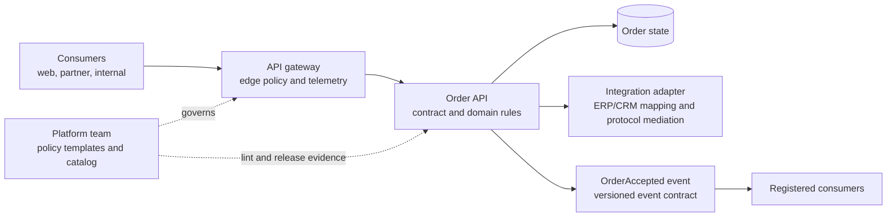

# API Architecture, Contracts, and Governance

**Study guide for senior/principal Enterprise and Integration Solution Architect interviews**  
**Scope:** Vendor-neutral design of synchronous APIs and their related event contracts. OAuth mechanics belong in the security guide; broker delivery mechanics belong in the messaging guide.

## 1. The architect's opening position

An API contract is a promise about **observable behavior**, not just a JSON shape. It covers resource meaning, operations, identifiers, security expectations, status codes, errors, ordering of effects, retries, limits, and change policy. The team that owns the business capability is the **producer and accountable contract owner**. A platform team can supply a gateway, tooling, and standards; it does not become the owner of order semantics. Each consumer owns its use of the contract, tests its assumptions, observes deprecation notices, and migrates before a published retirement date.

**Assumptions for examples:** A fictional Order service accepts orders from authenticated business clients, stores the authoritative order state, and emits an `OrderAccepted` fact after acceptance. Amounts are in a single ISO currency per order. The proposed limits, retention periods, and dates below are example policy choices, not universal standards. `api.example.com` and IDs are illustrative. The organization has an API catalog and a way to identify active consumers.

At a whiteboard, first ask: Who owns the order? Which clients create or read it? Is acceptance synchronous, or does fulfillment finish later? What is the expected peak, timeout budget, recovery objective, and regulatory constraint? Only then pick a route, gateway policy, and contract. Contract-first means producer and representative consumers agree on these semantics in a reviewable description *before* implementation. An OpenAPI document can describe paths, operations, parameters, responses, and security requirements; it cannot by itself prove that implementation behavior matches those descriptions. [OpenAPI Specification v3.2.1](https://spec.openapis.org/oas/v3.2.1.html).

## 2. Put each responsibility at the right boundary



| Boundary | Owns | Should not silently own |
|---|---|---|
| **Gateway** | TLS termination or pass-through as designed; route selection; edge authentication checks; coarse authorization where claims suffice; request size limits; rate limits and quotas; optional caching of explicitly cacheable reads; common correlation, access logs, metrics, and threat controls. | Whether an order is eligible for credit, how inventory is allocated, customer-specific entitlements requiring domain data, complex workflow, or canonical ERP mapping. |
| **Order API** | Resource state, validation, invariants, fine-grained authorization, transactions, idempotent business effects, status transitions, and contract behavior. | Generic edge traffic management or translation of every downstream application's peculiar data model. |
| **Integration adapter/mediation layer** | Protocol and data mapping to ERP/CRM, anti-corruption rules, partner-specific transformation, retries within a defined budget, and reconciliation of downstream outcomes. | Rewriting the public API's business meaning or hiding a distributed workflow behind an unbounded synchronous call. |

Gateways can reject an invalid credential or a caller lacking a broad `orders.write` permission; the Order service must still check whether that caller may create an order for the specified account. The trust boundary is explicit: only validated identity context reaches the service, and the service does not trust arbitrary caller-supplied identity headers. Keep authentication and authorization decisions observable without logging secrets or sensitive bodies. Document whether gateway and service both enforce a policy; overlapping checks can be useful defense in depth, but conflicting rules create unpredictable access.

Throttle **rate** (requests per short window) to protect capacity, and set **quota** (usage per day or billing period) for fairness or commercial policy. Define the subject (client, tenant, or account), burst allowance, counting method, and what happens when the gateway is unavailable. A `429 Too Many Requests` response can explain the limit and include `Retry-After`; the latter may be seconds or an HTTP date. Clients should back off with jitter and a bounded retry budget. A gateway limit cannot replace downstream concurrency controls: a permitted burst can still overwhelm a database or a slow ERP. [RFC 6585 §4](https://www.rfc-editor.org/rfc/rfc6585.html#section-4), [RFC 9110 §10.2.3](https://www.rfc-editor.org/rfc/rfc9110.html#section-10.2.3).

## 3. Design resources and operations around business meaning

Use `POST /orders` to create an order, `GET /orders/{orderId}` to fetch it, and `GET /orders` to search the caller's visible orders. A transition such as cancellation can be a domain operation (`POST /orders/{id}/cancellations`) when it has rules, an outcome, and a distinct audit record. Avoid a generic `/executeAction` endpoint that combines unrelated business behaviors into an opaque payload. Also avoid exposing a database table per endpoint: a resource is a stable business concept, not necessarily a storage row.

For a create operation, decide whether `201 Created` means a durable accepted order or only a queued request. If processing is genuinely asynchronous, `202 Accepted` plus a status resource may be clearer. Do not report success before the promised state exists. `GET` must not create an order as a side effect, and ordinary retries of a `POST` need an explicit deduplication policy. HTTP defines method semantics, including safe and idempotent methods; it does not make a particular business `POST` idempotent automatically. [RFC 9110 §§9, 15](https://www.rfc-editor.org/rfc/rfc9110.html).

For collections, specify stable sort order, filters, page size bounds, cursor lifetime, and whether a cursor is tied to filters and authorization context. Prefer an opaque cursor over an offset when inserts and deletes would shift result positions. Example: `GET /orders?status=accepted&limit=50&cursor=...` returns `items` and `nextCursor`; `nextCursor: null` means no more records at that moment. A cursor is not a promise of a frozen snapshot unless the API explicitly offers snapshot semantics. Consumers must expect duplicates or omissions under concurrent writes if the design does not guarantee consistency; deduplicate by `orderId` where appropriate. Avoid exposing database keys or predicates in the cursor.

Set a latency budget across caller, gateway, service, and downstreams. For example, if the caller times out at 3 seconds, a gateway timeout at 4 seconds and a service timeout at 10 seconds are incoherent. Reserve time for network and cleanup; do not let every layer retry the same slow request. A timeout is an **unknown outcome**, not proof that the operation failed. The client retries a create with the *same* idempotency key and payload, then checks the order/status resource if necessary. Return transient `503` only when service unavailable, `429` for rate limiting, and a stable problem type for machine action. Use `Retry-After` when the server can offer useful guidance, while keeping client retry budgets bounded. [RFC 9110](https://www.rfc-editor.org/rfc/rfc9110.html).

## 4. Concrete order API contract sketch

This is a compact, human-readable contract sketch; a production OpenAPI file should carry schemas, examples, response headers, and security requirements in machine-readable form. Field meaning and failure behavior matter as much as syntax.

```http
POST /orders HTTP/1.1
Content-Type: application/json
Authorization: Bearer <credential>
Idempotency-Key: "6d7a7d7b-6cc1-4e8a-a7f3-618c7b2142d5"
X-Correlation-ID: 71a1b19f-7239-46fe-ae67-32b061d7551f

{
  "clientOrderRef": "WEB-38172",
  "accountId": "A-1024",
  "currency": "USD",
  "lines": [{"sku": "SKU-7", "quantity": 2}]
}
```

**Request rules:** `clientOrderRef` is the client's reference, not the service's identity; it is unique per account for 90 days in this example. `quantity` is an integer greater than zero. The caller must be allowed to use `accountId`. Unknown fields are ignored only if the published schema and consumers' tooling support that policy; otherwise reject them consistently. A request must not include calculated totals or internal fulfillment state as authoritative input.

```http
HTTP/1.1 201 Created
Location: /orders/ord_01J8M4
Content-Type: application/json
X-Correlation-ID: 71a1b19f-7239-46fe-ae67-32b061d7551f

{
  "orderId": "ord_01J8M4",
  "clientOrderRef": "WEB-38172",
  "accountId": "A-1024",
  "status": "accepted",
  "currency": "USD",
  "lines": [{"sku": "SKU-7", "quantity": 2}],
  "createdAt": "2026-10-28T18:24:00Z"
}
```

`GET /orders/{orderId}` returns the same resource with its current state; `404` hides nonexistent or deliberately undisclosed orders according to the documented authorization policy. `GET /orders?limit=50&cursor=...` returns `{ "items": [...], "nextCursor": "opaque-or-null" }`. The producer defines whether an accepted order can later be rejected by fulfillment; if yes, `status` must distinguish those states. The consumer must not interpret `201` as “shipped.”

**Idempotency rule:** The client generates a fresh key per intended create and reuses it for retries. The producer scopes the key to tenant, client, and operation; atomically records the request fingerprint and durable outcome with the business create; retains the record for an example 24-hour retry window; and returns the original outcome for an identical retry. A key reused with a different payload returns `409` with a stable problem type. A simultaneous duplicate may return an in-progress response documented by the API. If the outcome cannot be recovered atomically, the design needs a reconciliation path. The `Idempotency-Key` header is the subject of an **active IETF Internet-Draft as of October 2026**, not a finalized RFC; publish the exact header syntax and local behavior rather than assuming universal interoperability. [IETF Idempotency-Key draft](https://datatracker.ietf.org/doc/draft-ietf-httpapi-idempotency-key-header/).

**Correlation rule:** The gateway accepts a well-formed `X-Correlation-ID` or generates one, returns it, and propagates it to logs and downstream calls. It identifies a request journey, not an order or an idempotent operation. Do not use it to deduplicate. Never trust it as proof of identity. Distinguish it from a distributed trace identifier if both are present.

```http
HTTP/1.1 422 Unprocessable Content
Content-Type: application/problem+json
X-Correlation-ID: 71a1b19f-7239-46fe-ae67-32b061d7551f

{
  "type": "https://api.example.com/problems/invalid-order-line",
  "title": "Invalid order line",
  "status": 422,
  "detail": "Quantity must be greater than zero.",
  "instance": "/problems/71a1b19f-7239-46fe-ae67-32b061d7551f",
  "code": "INVALID_QUANTITY",
  "field": "/lines/0/quantity",
  "correlationId": "71a1b19f-7239-46fe-ae67-32b061d7551f"
}
```

Use `400` for malformed syntax, `401`/`403` for authentication/authorization outcomes, `404` for an undisclosed or absent resource per policy, `409` for conflicting state or key reuse, `422` for valid syntax that fails business validation, `429` for rate limits, and `5xx` for server failures. Publish each stable `type`/`code` and which failures are retryable. The `detail` is human-readable; consumers must branch on stable fields, not parse prose. RFC 9457 defines `application/problem+json` and its standard members; extension fields such as `code` and `correlationId` are application choices. [RFC 9457](https://www.rfc-editor.org/rfc/rfc9457.html).

## 5. Separate event contract, separate compatibility question

The API's create response and the emitted event serve different consumers. The event is a past-tense fact owned by the Order producer, not an instruction to every subscriber. An event schema can be cataloged with an AsyncAPI description of channel, operation, message, and payload. CloudEvents supplies common envelope attributes; the domain team still owns payload semantics and consumer migration. [AsyncAPI Specification v3.1.0](https://www.asyncapi.com/docs/reference/specification/v3.1.0), [CloudEvents specification](https://github.com/cloudevents/spec/blob/main/cloudevents/spec.md?plain=1).

```json
{
  "specversion": "1.0",
  "id": "evt_01J8M5",
  "source": "https://api.example.com/order-service",
  "type": "com.example.orders.accepted.v1",
  "subject": "orders/ord_01J8M4",
  "time": "2026-10-28T18:24:01Z",
  "datacontenttype": "application/json",
  "correlationid": "71a1b19f-7239-46fe-ae67-32b061d7551f",
  "data": {
    "orderId": "ord_01J8M4",
    "accountId": "A-1024",
    "currency": "USD",
    "lines": [{"sku": "SKU-7", "quantity": 2}],
    "acceptedAt": "2026-10-28T18:24:00Z"
  }
}
```

Here `correlationid` is a documented custom CloudEvents extension. `source` plus `id` identifies a distinct event; a redelivery of that event keeps the same identity. `orderId` identifies the business entity; it is not the event ID. `type` identifies business meaning; `specversion` identifies the CloudEvents envelope version, not the domain schema version. The producer must state whether `OrderAccepted` means the order is durable, whether corrections produce a new event, and what data is safe for every subscriber to receive.

Register the payload schema under a stable subject and record the schema identifier with each message when the chosen transport supports it. Set compatibility policy to match the actual reader/writer relationship: older deployed consumers reading new messages, newer consumers replaying old messages, or both. For an Avro example, writer/reader schema resolution supports some promotions (such as `int` to `long`), but a `string` in place of an `int` is not an automatic safe promotion. A registry's compatibility check tests structural rules, not semantic changes such as a currency change or a field that now means something else. Test representative consumer code and replay old records as well. [Apache Avro specification](https://avro.apache.org/docs/1.12.0/specification/).

Safe evolution normally adds an optional field with a documented default/absence meaning, keeps existing names, types, units, and meanings, and teaches consumers to ignore unknown fields. Even an additive JSON field can break strict deserializers, generated clients, or consumers that reject unknown properties. Validate the *deployed* consumers, not an imagined tolerant reader. A new required request field breaks old callers; a new required event field can break readers of retained old records. Use explicit new event types or channels when the business meaning changes incompatibly; run old and new publication in parallel for a planned window, with separate IDs and a clear relationship so consumers do not process both as two orders.

## 6. Worked change: a field type that threatens many consumers

**Scenario:** The Order producer wants `accountId` to change from string `"A-1024"` to object `{ "system": "crm", "value": "A-1024" }` because several account systems can issue the same local ID. Twelve known consumers include a mobile app, CRM adapter, finance feed, and analytics jobs. An in-place type change may fail JSON parsing, generated SDK models, schema-registry checks, and equality joins. Worse, a consumer that ignores `system` may silently join the wrong account.

1. **Prevent:** The contract review labels `accountId`'s type and meaning as stable. Producer and consumers enumerate its use, including retained event replay and exported files. CI diffs OpenAPI and event schemas and rejects the in-place type change. Consumer-driven tests state concrete expectations (`accountId` is a string on the old contract), and the producer verifies them before release. A schema registry blocks incompatible event publication under the existing subject. A schema check will not detect every semantic or behavioral break. Pact's provider verification illustrates checking consumer expectations against a provider build before deployment. [Pact provider verification](https://docs.pact.io/provider).
2. **Introduce:** Keep old `accountId` as a string for existing accounts and add `accountReference` as an object in API responses and a new event payload version. For a new account whose local ID collides with an old one, do **not** return an ambiguous `accountId`. Hold that cohort behind a capability gate until the consumers that need it can handle `accountReference`; if the old API must serve such accounts, expose a separately versioned contract with explicit semantics. Publish the mapping and ownership rule for historical IDs. New consumers use `accountReference`; legacy clients continue to see only unambiguous orders.
3. **Detect and roll out:** Deploy dual-read consumers first; verify they accept old and new records, missing optional fields, and realistic values. Then deploy producer dual-write for a canary tenant. Watch provider contract verification, schema-registration failures, `4xx`/`5xx`, deserialization errors, rejected events, account join mismatches, and consumer lag. Confirm each consumer's migrated version and actual traffic; a catalog entry alone does not prove use has stopped. Expand by cohort after reconciliation reports show no misattribution.
4. **Rollback:** If the canary fails, stop new-format publication and the new-account capability gate, leave old fields and endpoints intact, and replay or repair affected records using stable event identities and an audited plan. Do not “rollback” by discarding the account system and guessing from the local ID. If new-format events have escaped, consumers need a quarantine or forward-fix path; deployment rollback cannot erase delivered facts. Remove the old field only after announced retirement, verified consumer migration, and a documented response for unsupported old clients.

The answer to “who owns the contract?” is operational here: the Order team owns both published contracts and the migration plan; the platform team supplies compatibility gates and visibility; each consumer team owns its code and must confirm readiness. The architecture group can adjudicate an exception, but cannot make an incompatible field magically safe.

## 7. Versioning, deprecation, and governance trade-offs

**Prefer additive evolution** when old and new consumers can interpret the same meaning: optional output fields, new endpoints, or a new filter whose omission preserves prior behavior. It reduces parallel deployments and documentation. It also accumulates old fields and requires tolerance of unknown fields. Do not call a changed field type, unit, default, or error meaning “additive.”

**Version explicitly** when meaning or shape cannot coexist safely, when a field cannot be represented for old clients, or when a major authorization/behavior change alters client obligations. URI major versions such as `/v2/orders` are easy to route and observe; media-type or header versions keep resource URIs stable but can be harder for some clients and tooling to discover. Pick one style consistently and version the smallest coherent contract surface. Versions have carrying cost: duplicated tests, security rules, documentation, telemetry, support, and a migration period. A new version is a migration mechanism, not permission to abandon the old one overnight.

Publish a policy with dates, affected operations and event types, replacement, migration examples, contact, and support window. Mark deprecated OpenAPI operations and communicate directly with registered consumers. HTTP's `Deprecation` response header can signal a deprecation date; `Sunset` can signal when a URI is expected to stop responding. They use different date formats, and deprecation alone does not change resource behavior. Validate dates and scope, monitor remaining traffic, and retire only after a decision based on actual usage and obligations. [RFC 9745](https://www.rfc-editor.org/rfc/rfc9745.html), [RFC 8594](https://www.rfc-editor.org/rfc/rfc8594.html), [OpenAPI Specification v3.2.1](https://spec.openapis.org/oas/v3.2.1.html).

**Centralized standards** are valuable for naming, identity propagation, error envelopes, API descriptions, catalog metadata, baseline security, observability, and change gates. They lower consumer learning cost and make platform controls repeatable. Overly prescriptive central approval for every resource or domain status can delay teams and push business decisions to people without domain context. A practical model is a small mandatory baseline, reusable templates, automated lint and tests, and a documented exception path. Domain teams retain resource semantics and release accountability; a lightweight architecture review handles cross-domain coupling or exceptions. Measure governance by escaped breaks, migration lead time, and consumer experience, not the number of approvals.

## 8. Lifecycle checklist: discovery to retirement

| Stage | Producer / contract owner | Consumer | Platform / governance |
|---|---|---|---|
| **Discover** | Identify capability, authoritative data, allowed operations, data classification, owners, NFRs, and known consumers. | State use cases, volume, latency, data needs, and failure tolerance. | Provide catalog and discover duplicate capabilities. |
| **Design** | Draft OpenAPI/event schemas, examples, error catalog, limits, pagination, timeout and idempotency behavior; label assumptions. | Review meanings, request examples, retry behavior, and migration constraints. | Apply security and style baseline; record exceptions. |
| **Validate** | Prototype hard cases; run schema diff, provider verification, integration and authorization tests; define SLOs. | Publish consumer contract tests and test against realistic failures and unknown fields. | Supply CI gates, test environments, schema registry, and catalog. |
| **Launch** | Publish docs, owner, support route, version, change log, limits, and runbook; roll out by cohort. | Register application/contact, pin supported contract, instrument failures, and use bounded retries. | Configure gateway policies and traffic/consumer visibility. |
| **Operate** | Monitor latency, error codes, quota pressure, contract drift, adoption, and ambiguous outcomes; reconcile. | Monitor own errors and deprecation signals; report undocumented behavior. | Track policy drift and alert on broad failures. |
| **Evolve** | Classify changes; verify deployed consumers; add or version; stage, canary, and prepare rollback. | Upgrade, verify and acknowledge readiness; tolerate documented additive fields. | Enforce compatibility and publish migration status. |
| **Retire** | Announce dates and replacement, watch residual traffic, preserve required records, then remove routes and schemas on schedule. | Migrate and confirm zero dependency, including batch jobs and replay. | Remove gateway policies and catalog entries only after owner sign-off. |

## 9. Five interview questions with model answers

1. **What belongs at the gateway?** “Cross-cutting edge controls: routing, credential validation, coarse access checks, rate limits, request limits, and telemetry. The Order service owns eligibility, state transitions, and fine-grained authorization. An adapter owns ERP mapping. I test the trust boundary and ensure a gateway outage or configuration change cannot silently bypass domain rules.”
2. **Who owns an API contract?** “The producer team owning the business capability is accountable for semantics, documentation, compatibility, release, and deprecation. Consumers own their assumptions, tests, and migration. Platform governance supplies common controls and visibility. I name an actual on-call owner and escalation route in the catalog.”
3. **How do you make order creation safe to retry?** “Use a client-generated key per intended order, scoped and stored atomically with the create outcome. Repeating the same key and payload returns the same outcome; conflicting reuse fails. Correlation IDs support tracing, not deduplication. After a timeout, the result is unknown, so retry with the same key or query status.”
4. **When do you introduce v2?** “When a type, meaning, required input, authorization obligation, or behavior cannot be preserved for old clients. I first see whether an optional field and a staged consumer migration solve it. If not, version the coherent surface, run both for a published window, and measure real consumer usage before retirement.”
5. **Will a registry or consumer-driven test guarantee compatibility?** “No. The registry checks schema rules for its configured format and direction; consumer tests check registered expectations against a provider build. Neither discovers every unknown consumer or semantic change. I combine them with inventory, representative end-to-end tests, canaries, and runtime monitoring.”

## 10. Mistakes to avoid and a short exercise

**Mistakes:** Putting credit policy in gateway scripts; treating `201` as completion of downstream fulfillment; retrying timed-out `POST`s with new keys; using a correlation ID as an idempotency key; changing a type in place because JSON permits both; assuming all readers ignore extra fields; using a registry's “compatible” result as proof of business compatibility; hiding `429` as `500`; launching v2 without a migration owner; retiring an API based only on catalog declarations; dual-publishing events without preventing double business effects.

**Exercise (five minutes):** An order API returns `estimatedDeliveryDate` as an optional ISO date string. The producer wants to replace it with `{ "earliest": "...", "latest": "..." }`. Six consumers exist; two are unknown versions, and a nightly batch reads old event history. Sketch a safe contract change and name the evidence needed before retirement.

**Answer key:** Add an optional `deliveryWindow` object while retaining `estimatedDeliveryDate` with its original meaning for representable orders. Publish the object schema and absence rules. Identify deployed consumers through registration and traffic, add consumer tests, run provider verification and event compatibility checks, and replay old event samples through new readers. Migrate consumers to read either representation; canary and monitor parse errors and business discrepancies. If a range cannot be faithfully reduced to the old single date, do not fabricate one: gate those orders away from old clients or expose a versioned contract/event type. Announce deprecation and a retirement date; retire only when runtime traffic, batch jobs, replay, and consumer acknowledgements show the old field is no longer required. Have a rollback that stops new-format emission without erasing delivered events.

**One-sentence answer to practice aloud:** “The capability owner publishes and operates the contract; consumers publish their dependencies; every incompatible change gets a measured migration path, with compatibility checks before release and an observable way back.”
