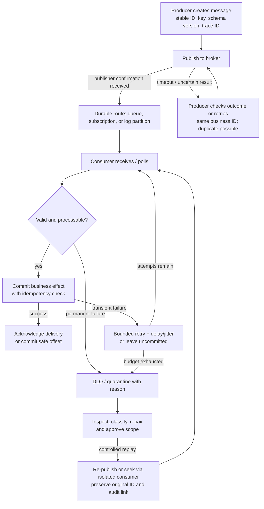

# Enterprise Messaging: Queues, Topics, and Event Streams

**Study guide for senior/principal Enterprise and Integration Solution Architect interviews**  
**Scope:** Messaging architecture and operation. Product examples illustrate semantics; validate limits and defaults for the chosen service and version.

## 1. Start with the contract, not the product

A message broker accepts a producer's message and makes it available later. That separation absorbs bursts and outages, but it does not finish the business operation. Specify **who must act, when work expires, how success is acknowledged, what may repeat, and how operators recover**.

**Labeled assumptions used throughout:** Examples are illustrative, not claims about an employer's systems. “Durable” means the chosen broker configuration acknowledges a publish only after its documented persistence/replication condition; it does not mean immunity to every regional disaster. A consumer's business action is assumed to use an external database or API unless stated otherwise. No ordering guarantee is assumed across distinct queues or partitions. The event examples contain no payment credentials or other unnecessary sensitive data.

| Building block | Meaning | Operational consequence |
|---|---|---|
| **Queue** | Work items wait for one of several competing workers. Successful settlement removes an item from normal delivery. | Good load leveling; backlog needs capacity, age, and expiry controls. |
| **Topic with subscriptions** | A publish is routed to each matching subscription; each subscription has its own delivery state, often queue-like. | Independent consumers need independent subscriptions and monitoring. A failed subscriber need not stop others, but fan-out increases deliveries and cost. |
| **Retained event log** | Records are appended to partitions and remain until retention or compaction removes them; reading does not delete them. A consumer group tracks a position. | Reprocessing and new readers are practical within the retained window; storage, replication, and group operations have continuing cost. |
| **Broker** | The service that routes/stores messages and enforces its own acknowledgement, replication, and retention rules. | Broker health, quotas, network access, and recovery are part of the application design. |

These are patterns, not exclusive product categories: a broker can provide queues and streams. Azure Service Bus documents competing consumers and independent subscriptions; Kafka documents retained, partitioned topics. [Azure Service Bus queues and topics](https://learn.microsoft.com/en-us/azure/service-bus-messaging/service-bus-queues-topics-subscriptions), [Apache Kafka introduction](https://kafka.apache.org/intro/).

```text
Work command:  Producer ──> [fulfillment queue] ──> worker A OR worker B

Event fan-out: Order service ──> [order topic] ┬─> CRM subscription ──> CRM workers
                                           └─> Analytics subscription ──> pipeline

Retained log: Order service ──> [partition 0: ... 81, 82, 83 ...]
                              [partition 1: ... 34, 35, 36 ...]
                                   ├─> CRM group (its offsets)
                                   └─> Analytics group (its offsets)
```

An **event** reports a fact such as `OrderAccepted`; a **command** requests an action such as `AllocateInventory`. An event publisher should not assume every reader is available. A command needs an intended capability and an observable outcome.

## 2. Queue versus Kafka-like stream: decision matrix

“Traditional queue” here means a durable broker queue with competing consumers and settlement. “Kafka-like stream” means a retained, partitioned log with consumer-group offsets. A topic with independent queue-like subscriptions is a third useful option, especially for fan-out without broad replay needs.

| Decision point | Durable queue / topic subscriptions | Kafka-like event stream | Architect's test and cost consequence |
|---|---|---|---|
| Command and work distribution | Natural fit: one worker completes each command; retry and DLQ are common facilities. | Possible, but per-partition head blocking and offset management make arbitrary work retries harder. | Is this an instruction to one capability? Queue usually reduces custom retry code and operator skill required. |
| Multiple independent consumers | Use a topic and one subscription per consumer; a single shared queue is **not** fan-out. | Use a separate group per independent application; each group maintains its own position. | Count delivery copies, group/subscription count, network, and downstream load. |
| Replay and new consumers | Usually requires an explicit archive, re-publish plan, or broker-specific retention feature; consumed work is normally gone. | A group can seek to retained offsets or start anew within the retention window. | Replay can trigger duplicate external actions; budget for isolation, audit, and extra read traffic. |
| Scale and throughput | Add workers until broker, downstream, ordering, or concurrency limits dominate. | Partition count bounds parallel consumption within a conventional group; add partitions for more lanes, with key/order implications. | Benchmark message size, batching, peak rate, and slowest dependency rather than using product labels as a throughput promise. |
| Ordering | Queue insertion order need not equal completion order with competing workers, retries, or priorities. | Order is within one topic-partition, not across the topic; key related records consistently. | Strict per-entity order consumes a serial lane and can create hot keys. |
| Retention | Usually bounded by TTL, queue capacity, and DLQ policy; backlog is pending work. | Records remain for configured time/size, independent of reads; compaction has different semantics from a complete history. | Size storage for peak ingest × retention × replication plus headroom; check privacy/deletion duties. |
| Expertise | Queue/subscribe operations are often simpler, though routing and redrive still need discipline. | Requires partition-key design, group/offset operations, rebalances, schema evolution, and replay controls. | Include on-call training and failure drills in total cost. |
| Total cost | Service requests, delivery copies, retained backlog, DLQ storage, workers, support. | Brokers/managed capacity, partition overhead, replicated retention, egress, processing, replay traffic, support. | Compare a workload-level TCO at peak and during outage, not a unit price or open-source license. |

Kafka documents per-partition ordering and retention independent of reads. Its topic settings distinguish time/size deletion from compaction, which keeps the latest value per key rather than a complete event history. RabbitMQ notes that competing consumers and requeueing can change observed queue order. [Kafka introduction](https://kafka.apache.org/intro/), [Kafka topic configurations](https://kafka.apache.org/44/configuration/topic-configs/), [RabbitMQ queues](https://www.rabbitmq.com/docs/queues).

**Decision in one sentence:** Choose a queue for workers completing commands; topic subscriptions for several applications needing independent delivery; a retained stream when multiple readers, high throughput, or governed replay are core requirements. A fulfillment adapter can turn an order event into a command. Two patterns need not require two products.

## 3. The message lifecycle and its failure points



**Publisher confirmation** answers whether the broker accepted the publish under its configured durability rules. **Consumer acknowledgement** answers whether a particular delivery can be removed or advanced. They are separate protocols: one does not prove the other. For queue consumers, a crash after the business effect but before acknowledgement can cause redelivery. For a log consumer, committing an offset before the effect risks loss; committing after the effect risks repeat. RabbitMQ documents publisher confirms, manual acknowledgements, and prefetch as separate controls. [RabbitMQ confirms and acknowledgements](https://www.rabbitmq.com/docs/confirms).

An uncertain publish result is a dual-write concern: a timeout does not prove rejection. Use stable IDs for safe producer retries; where a database change and publish must agree, use a transactional outbox or equivalent handoff.

**Retry policy:** Retry transient faults with a bounded attempt/time budget and jitter. Do not tight-loop a malformed record. A queue can delay and redeliver or move it to a DLQ. In a conventional partition-ordered stream, skipping advances past the failed record; retrying blocks that partition. A skip/quarantine policy must record original topic, partition, offset, key, payload reference, reason, and decision. Later replay may violate original order or create stale effects. DLQs require an operating workflow. [Azure Service Bus dead-letter queues](https://learn.microsoft.com/en-us/azure/service-bus-messaging/service-bus-dead-letter-queues).

## 4. Delivery semantics: state the boundary

| Claim | What happens at the consumer boundary | Typical trade-off |
|---|---|---|
| **At-most-once** | The broker position is advanced or the delivery removed before processing, or automatic acknowledgement treats receipt as success. A crash can lose work; this delivery path does not redeliver it. | Low duplicate handling, but unacceptable for critical fulfillment or billing. |
| **At-least-once** | Settle or commit position after processing. A crash or acknowledgement uncertainty can repeat a delivery. | Usually the practical default for important work; consumers must be idempotent. |
| **Exactly-once within a stated scope** | A transaction coordinates input position with output in the same supported system, or a destination atomically stores its effect and deduplication/offset state. | Stronger invariant, narrower scope and more complexity; name the source, destination, failure cases, and transaction boundary. |

Kafka's transactional producer plus committed-read consumers can atomically coordinate consumed offsets and produced Kafka records for a read-process-write **Kafka-to-Kafka** pipeline. Kafka explicitly says an external destination must cooperate to extend this property. A broker cannot alone guarantee one card charge, invoice, or CRM mutation. Consider: billing API succeeds, then the consumer crashes before acknowledging. The broker must redeliver; a second call can bill again unless billing accepts a stable idempotency key or the business system enforces a unique operation ID. Even an idempotent database update does not undo an earlier non-idempotent external call. Reconciliation is still needed for ambiguous outcomes. [Kafka design: delivery semantics](https://kafka.apache.org/44/design/design/), [Azure Service Bus message loss and duplicates](https://learn.microsoft.com/en-us/azure/service-bus-messaging/service-bus-message-loss-and-duplicates).

Do not say “exactly-once” without scope. Distinguish **broker accepted once**, **delivered once**, **handler ran once**, and **business effect occurred once**. Producer retries, redelivery, and replay can each revisit work. Use a durable key such as `charge:{orderId}:{chargeType}` and destination-side uniqueness or API idempotency. Retain that key through the retry and replay horizon.

## 5. Capacity, ordering, and recovery economics

**Concurrency is bounded by the narrowest stage.** For independent queue work, estimate workers as `peak arrival rate × mean processing time ÷ target utilization`, then test tail latency and downstream quotas. Example: 120 messages/s × 0.2 s ÷ 0.6 ≈ **40 active workers**. In a conventional Kafka group, one member owns each partition, so ten partitions offer at most ten partition lanes. Parallel tasks within a member can exceed ten in-flight operations, but preserving per-key completion order becomes the application's responsibility. [Kafka design](https://kafka.apache.org/44/design/design/).

Choose a partition key from the ordering requirement: `orderId` keeps an order's events together; a constant key collapses throughput into one hot partition; a random key gives distribution but no per-order order. Increasing partitions can alter future key placement, so assess ordering and replay effects before resizing. A “FIFO queue” also needs a defined boundary: with multiple workers, completion order can differ from receipt order, and retries can change observed order. [Kafka introduction](https://kafka.apache.org/intro/), [RabbitMQ queue semantics](https://www.rabbitmq.com/docs/semantics).

**Backpressure:** Bound in-flight deliveries and downstream concurrency; allow backlog only within an age/capacity budget. RabbitMQ's prefetch limits unacknowledged deliveries; unbounded prefetch can grow consumer memory, while tiny values waste throughput. A log gives consumers time to catch up only while records remain. Estimate catch-up as `backlog ÷ (processing rate − new arrival rate)`; with no spare rate, backlog never clears. [RabbitMQ confirms and acknowledgements](https://www.rabbitmq.com/docs/confirms), [Kafka topic configurations](https://kafka.apache.org/44/configuration/topic-configs/).

**Retention is a recovery deadline, not a backup.** A queue's TTL or max length can remove pending work; a log's age/size limit can delete records before a slow group reads them. DLQ records can themselves require storage, access control, and disposal. Replication protects against specified broker failures, but it multiplies storage and does not fix a bad event, accidental replay, or wrong downstream action. Measure worst-case outage duration plus repair and catch-up time before selecting retention. Keep payloads lean; link to large objects whose lifecycle and access policy are managed separately.

## 6. Four worked scenarios

### A. Distribute fulfillment work

**Assumptions:** One order requires one fulfillment action; the warehouse API may time out; duplicate actions are unacceptable. Send `FulfillOrder` with a stable command ID to a durable queue. Workers use manual settlement, bounded in-flight work, and a command-ID check. The warehouse must enforce that ID or support outcome lookup; mark success only after confirmation. Retry temporary failures with delay; quarantine invalid addresses and exhausted attempts. Query ambiguous outcomes before retrying. Scale workers against warehouse limits. **Cost:** broker delivery/storage, workers, DLQ operations, outage backlog. **Reject:** one shared queue for CRM and fulfillment; each would steal messages from the other.

### B. Notify CRM and analytics of an order event

**Assumptions:** `OrderAccepted` is a fact; CRM and analytics have different availability and latency targets. Publish once to a topic with two independent subscriptions, or to a retained stream with two consumer groups if new readers and replay are strategic requirements. CRM can update an account view using order ID/version idempotently; analytics can append to an ingestion pipeline with its own deduplication. CRM failure accumulates **its** backlog while analytics proceeds. Define event schema ownership, stable event ID, and no promise that the two consumers finish simultaneously. **Cost:** fan-out doubles deliveries; long stream retention adds storage and data governance. **Reject:** treating a single queue with two worker types as broadcast.

### C. Recover from a consumer outage

**Assumptions:** Analytics is down for six hours; ingest is 100 events/s, so roughly 2.16 million events accrue. If restored capacity is 250 events/s while new events continue at 100/s, spare capacity is 150/s and ideal catch-up takes about **four hours** (`2.16m ÷ 150`). Allow more for skew, retries, and downstream limits. Confirm the queue has capacity and TTL beyond outage plus catch-up, or the stream retains the earliest unread offsets. Restart consumers gradually, cap downstream writes, watch oldest-message age or per-partition lag, and verify counts against source records. If the retention window was exceeded, use a separately governed source-of-truth backfill, not a blind offset reset. **Cost:** accumulated storage plus catch-up compute, requests, and network; a larger worker fleet may simply overwhelm analytics.

### D. Isolate a poison message

**Assumptions:** One record has an unsupported schema version; healthy records must progress. On a queue, classify it as permanent, move it to a DLQ with reason and trace context, and acknowledge/remove it from the main path according to the broker's safe transfer semantics. On an ordered stream, choose explicitly between pausing that partition for repair and quarantining then advancing its offset. The latter allows later records through but breaks strict in-order **business processing** for that key. After code or data repair, replay one audited ID into an isolated lane, check downstream state, then expand scope. **Cost:** DLQ storage and operator time; strict order can lower availability for every key sharing the partition. **Reject:** immediate infinite retry, silent skip, or bulk redrive without deduplication.

## 7. What to monitor and ask in an interview

| Signal | What it diagnoses | Action when it moves the wrong way |
|---|---|---|
| Publish failures, confirm latency, broker throttle, replica health | Producers cannot safely hand off or broker capacity is strained. | Check quota, network, storage, replication; avoid unbounded producer retry. |
| Queue depth **and oldest-message age** | Pending work and customer waiting time; depth alone hides slow large items. | Compare arrival/complete rates; add safe capacity or shed/defer load. |
| Per-group/per-partition lag and **lag age** | Stream consumer may lose replay window; a hot partition hides in aggregate lag. | Inspect key skew, stalled consumer, rebalances, downstream latency. |
| In-flight count, processing p95/p99, ack/lock expiry | Too much parallel work or insufficient processing time budget; redelivery risk. | Bound concurrency, extend valid leases, fix slow dependency. |
| Retry rate, redelivery count, DLQ inflow and oldest DLQ age | Transient incident or unhandled poison traffic. | Classify, repair, and run controlled replay; alert on sustained flow. |
| Duplicate suppression rate and reconciliation mismatch | Producer/consumer ambiguity or incomplete business idempotency. | Trace stable IDs through publish, handler, and destination. |

Kafka exposes consumer lag and fetch metrics; RabbitMQ documents consumer prefetch and capacity; the portable design is to alert on **time until the business SLA or retention deadline is breached**, not a universal fixed message count. [Kafka monitoring](https://kafka.apache.org/44/operations/monitoring/), [RabbitMQ consumers](https://www.rabbitmq.com/docs/consumers).

**Interview questions and model answers**

1. **“Kafka or a queue for fulfillment?”** “A durable queue with competing workers fits a command completed once by one capability. I would define manual acknowledgement, idempotency, retry budget, DLQ inspection, and capacity from warehouse throughput. I would use a stream if retained facts and independent replay were central, then explain how work retries avoid partition blocking.”
2. **“How do CRM and analytics both receive an order?”** “Give each an independent subscription or consumer group. A shared competing queue would split deliveries. I would define schema and event ownership, then measure each reader's lag separately.”
3. **“Does Kafka guarantee exactly-once billing?”** “Its transaction can coordinate Kafka input offsets and Kafka output records. The billing API is outside that transaction. I need a stable operation key accepted by billing or enforced in its store, plus reconciliation for uncertain calls.”
4. **“Why is my queue FIFO yet updates are out of order?”** “Broker insertion order is not completion order. Multiple workers, prefetch, retries, and priorities can reorder observed effects. Key by entity and serialize that entity where order is required; quantify the resulting throughput cap.”
5. **“A consumer is down: should we increase partitions?”** “First compare backlog age with retention and calculate the spare catch-up rate. More partitions only help if partition lanes are the bottleneck and downstream capacity exists; changing partition count may affect key placement.”

**Common mistakes:** Equating an acknowledgement with a completed external action; calling a queue topic “replayable” without an archive; promising global order from a partitioned log; using one queue for independent subscribers; scaling consumers without checking the target system; treating a DLQ as an unowned graveyard; and redriving records into production before checking idempotency, age, schema, and side effects.

## 8. Practice exercise and answer key

**Exercise (10 minutes):** A retailer emits 80 `OrderAccepted` events/s, peaks at 400/s for 15 minutes, and must inform CRM and analytics. CRM may be unavailable for eight hours. Analytics wants to rebuild its projection from the last seven days. A fulfillment service must allocate each order once; a malformed order must not stop healthy work. Assume average fulfillment work takes 250 ms and warehouse permits at most 60 concurrent calls. Sketch the channels, IDs/keys, acknowledgement points, retry/DLQ policy, and two capacity checks. Explain the exact scope of any “exactly-once” claim.

**Answer key:**

1. Publish `OrderAccepted` with event ID, `orderId` key, schema version, and trace ID to a retained stream with at least seven days of usable retention **plus a margin for repair and catch-up**. Give CRM and analytics separate groups. The seven-day rebuild is a clear reason for retention; check storage, replication, security, and replay cost. A topic/subscription plus a separate event archive is a valid alternative if its replay operation is designed and tested.
2. Have a fulfillment adapter convert each relevant event to a stable `FulfillOrder` command on a durable work queue. Workers store/check the command ID and use the warehouse's idempotency key or outcome lookup. Settle after the durable business outcome; bound retries and quarantine permanent errors with reason. The adapter's handoff must also tolerate crash/retry without losing or duplicating the command's *business effect*.
3. At 400/s for 900 s, peak arrivals are **360,000** events. Eight hours at baseline 80/s is **2,304,000** events for CRM to catch up, before any peak overlap. Verify retained capacity and the CRM group's earliest offset. At 250 ms per call, 60 warehouse calls can complete at most about **240/s** in the ideal no-overhead case, below the 400/s peak; the queue must absorb the 15-minute spike and have an age/TTL budget. A realistic sustainable rate is lower. If peak begins with empty backlog, even ideal capacity leaves at least `(400 − 240) × 900 = 144,000` fulfillment commands pending; at 80/s new work and 240/s processing, ideal drain takes 15 minutes after the peak.
4. No broker setting alone proves “allocate once” in the warehouse. The defensible claim is **at-least-once delivery with effectively one allocation per stable command ID**, contingent on the warehouse's enforced idempotency and reconciliation. A Kafka-to-Kafka transformation may have exactly-once scope inside Kafka; that statement does not extend to CRM or warehouse APIs.

### Primary sources consulted (current documentation)

- [Apache Kafka: Introduction](https://kafka.apache.org/intro/) — event keys, partitions, ordering, retention.
- [Apache Kafka: Design](https://kafka.apache.org/44/design/design/) — delivery and transaction scope.
- [Apache Kafka: Topic configurations](https://kafka.apache.org/44/configuration/topic-configs/) — retention and compaction behavior.
- [Apache Kafka: Monitoring](https://kafka.apache.org/44/operations/monitoring/) — lag and throughput signals.
- [RabbitMQ: Consumer acknowledgements and publisher confirms](https://www.rabbitmq.com/docs/confirms) — settlement, confirms, prefetch.
- [RabbitMQ: Queues and semantics](https://www.rabbitmq.com/docs/queues) — observed ordering limits.
- [Microsoft: Azure Service Bus queues, topics, and subscriptions](https://learn.microsoft.com/en-us/azure/service-bus-messaging/service-bus-queues-topics-subscriptions) — competing consumers and fan-out.
- [Microsoft: Azure Service Bus dead-letter queues](https://learn.microsoft.com/en-us/azure/service-bus-messaging/service-bus-dead-letter-queues) — DLQ behavior and inspection.
