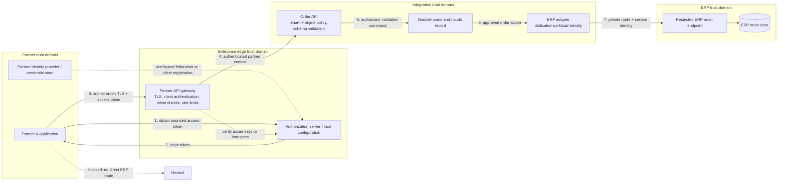

# Securing Enterprise Integrations

**Study guide for senior/principal Enterprise and Integration Solution Architect interviews**  
**Scope:** Vendor-neutral design for external partners, APIs, messaging, and internal applications. Examples are illustrative, not a claim about a particular enterprise. Standards and legal references were checked on **28 October 2026**.

## 1. Start with the trust decision

An integration crosses several boundaries: the partner's organization, the public or private transport, the enterprise edge, the integration runtime, and the system of record. At each crossing, ask: **Who or what is calling? What evidence supports that identity? What exact action and data are allowed? Who enforces the decision? What record proves the decision later?** Authentication establishes an identity claim; authorization decides an action in context. A valid token, certificate, network route, or signed message does not by itself authorize a particular order.

Design for a compromised partner account, leaked client secret, malformed payload, abused retry path, and an internal service with excess privileges. Inventory **data flows and trust boundaries** before selecting products. For each hop, mark the principal, credential, protocol, allowed operations, data classification, policy enforcement point, logging owner, and failure behavior. Threat-model spoofing (a stolen credential), tampering (changed order amount), repudiation (disputed submission), information disclosure (cross-partner reads), denial of service (flooded intake), and privilege escalation (an adapter using an ERP administrator account). Test the design against the concrete abuse paths, especially object-level authorization: an authenticated partner must not be able to change an order ID and read another partner's record. [OWASP API1:2023](https://api-security.owasp.org/editions/2023/en/0xa1-broken-object-level-authorization/).

NIST's zero-trust guidance says network location or asset ownership alone does not grant implicit trust. That does **not** make network controls irrelevant: segmentation reduces reachability and blast radius while identity and resource-level policy decide access. [NIST SP 800-207](https://csrc.nist.gov/pubs/sp/800/207/final), [NIST SP 800-207A](https://csrc.nist.gov/pubs/sp/800/207/a/final).

## 2. External partner to ERP: draw the boundary

**Scenario assumptions:** Partner A submits purchase orders. The ERP is authoritative for booking. The partner may submit and query only its own orders. The integration layer maps a public order contract to an ERP operation and records an immutable business outcome. There is no direct partner route or credential to the ERP.

The boundary is enforced in **layers**. The gateway accepts only registered partner credentials and tokens for the intended API audience, rejects expired or invalid tokens, and limits request size and rate. It maps the authenticated principal to a server-side `partner_id`; it does not trust a partner-supplied tenant field. The Order API authorizes the *operation* and *object*: Partner A can submit orders for its contracted accounts and query only orders bound to A. It validates schema, permitted fields, quantity and value constraints, and idempotency keys before recording a command. It does not pass arbitrary ERP fields, queries, or endpoints through.

Only the adapter can reach the restricted ERP endpoint. Its separate service identity has the minimum ERP function and record scope needed to create orders; it cannot administer users, read payroll, or run general queries. Firewall or private connectivity rules permit only adapter-to-endpoint traffic. The ERP enforces its own permissions and business rules. The adapter maps fields from a reviewed contract and never acts as a generic proxy. Audit records link partner principal, client ID, business order ID, authorization decision, command ID, adapter identity, and ERP reference. If any layer fails open, the whole boundary is weakened; test denied cross-partner reads, forbidden fields, direct ERP reachability, and adapter privilege misuse. [NIST SP 800-207A](https://csrc.nist.gov/pubs/sp/800/207/a/final), [OWASP API1:2023](https://api-security.owasp.org/editions/2023/en/0xa1-broken-object-level-authorization/).

## 3. Choose identity mechanisms for the claim they actually make

OAuth 2.0 names four roles: **resource owner** (the party able to grant access), **client** (the application requesting access), **authorization server** (issues access tokens), and **resource server** (protects the API). An access token represents authorization to access a resource, subject to its audience, scope, lifetime, and the resource server's own policy. In a user-facing partner portal, the authorization-code flow sends the user to the authorization server; the client exchanges the returned code for tokens. Use PKCE for public clients, and generally for confidential clients too. Current OAuth security guidance requires PKCE for public clients, recommends it for confidential clients, and says the resource-owner-password grant must not be used. For machine-to-machine partner submissions, client credentials can represent the client acting under a prearranged authorization; there is no end-user authentication in that flow. [RFC 6749](https://www.rfc-editor.org/rfc/rfc6749.html), [RFC 9700](https://www.rfc-editor.org/rfc/rfc9700.html).

OpenID Connect (OIDC) adds an **authentication** layer to OAuth. Its ID token tells the relying application about the end user's authentication at an OpenID Provider; it is not the partner API's access token. Validate it for the relying application's expected issuer, audience, signature, time, and transaction binding as applicable. An API should validate an **access token meant for that API**, not accept an ID token merely because it is signed. [OpenID Connect Core 1.0](https://openid.net/specs/openid-connect-core-1_0.html).

| Mechanism | Good fit | What it establishes when correctly configured | What it does **not** establish |
|---|---|---|---|
| **OAuth 2.0 access token** | Bounded API access; delegated user access or client-credentials service access | An authorization server issued a token for a client/resource and declared scope or other claims; the API can validate the token and policy | That the caller owns a specific order; that a human is present in client-credentials flow; that a bearer token was not stolen |
| **OIDC ID token** | Sign-in to a portal or application | The OpenID Provider asserts an end-user authentication event to the intended relying party | Permission to call an arbitrary API or manipulate an ERP record |
| **mTLS** | High-trust partner or service connections, especially where a managed certificate lifecycle is feasible | The TLS peer proves possession of the private key for an accepted client certificate; TLS protects that connection | Business authorization, tenant ownership, safety of payload, or identity of a human user |
| **API key** | Identifying a low-complexity client or metering, with tightly scoped server-side policy | Possession of a shared secret associated with a registered client | A human identity, request integrity, granular authorization, or resistance to replay after theft |
| **Federation (for example OIDC or SAML)** | Workforce/partner user sign-in across organizations | An IdP asserts an authentication event and selected attributes to a relying party under a trust agreement | That asserted groups automatically confer local application rights or that the partner application may access the ERP |

Federation separates the partner's identity provider from the enterprise relying party. Agree on trusted issuer, signing keys, allowed audiences, required authentication strength, attribute meanings, deprovisioning, session lifetime, and incident contacts. Map external attributes to **local roles** deliberately; group names from another organization are input to policy, not policy itself. NIST SP 800-63C describes IdP assertions and notes that authorization and access control at the relying party are outside its federation requirements. [NIST SP 800-63C](https://pages.nist.gov/800-63-4/sp800-63c.html).

mTLS is useful when both sides can provision, renew, and revoke certificates and when stronger client authentication or token replay resistance justifies that work. It can authenticate an OAuth client to the authorization server; separately, a **certificate-bound access token** can require the resource caller to prove possession of the same certificate. Those are distinct options. At a TLS-terminating proxy, protect the path carrying verified client identity to the application; never trust a client-written forwarding header. mTLS complements scoped OAuth and per-order checks. [RFC 8705](https://www.rfc-editor.org/rfc/rfc8705.html).

## 4. Make authorization local and specific

Define policy in verbs and resources: `partner:A may create order for account A-17`, `partner:A may read order X if X.partner_id=A`, `adapter:orders may invoke ERP.CreateOrder`. Validate **issuer, audience, expiry, client identity, scope, and token binding where used** at the API boundary, then evaluate the domain rule using server-owned data. A scope such as `orders.write` is coarse; it does not prove ownership of account A-17. Check every read, write, search, retry, callback, and bulk endpoint. Deny by default; do not let omitted tenant fields mean “all tenants.” Propagate only the partner context and claims the next service needs, with integrity protection and a clear trust chain.

For service identity, give each workload its own principal and permission set. Avoid a shared “integration” account across dozens of flows: it defeats attribution and makes rotation and containment broad. Prefer short-lived credentials or managed workload identity where supported; store long-lived credentials in a secrets manager with narrow read rights, monitored use, explicit owners, and tested rotation. Rotation must update consumers safely and revoke the old credential; changing a configuration value without disabling the exposed secret is not containment. Separate runtime permissions from deployment and administration permissions. [OWASP Secrets Management Cheat Sheet](https://cheatsheetseries.owasp.org/cheatsheets/Secrets_Management_Cheat_Sheet.html).

## 5. Protect the route and the data

Transport encryption protects data **on a connection**; it does not protect a payload after termination, during a queue wait, in logs, or in a partner's storage. Use supported TLS configurations with certificate validation on every external and internal sensitive hop, including gateway-to-service and adapter-to-ERP. Record where TLS terminates and who can inspect plaintext. NIST's TLS publication is written for U.S. federal use; its exact requirements should not be copied as universal legal obligations. [NIST SP 800-52 Rev. 2](https://csrc.nist.gov/pubs/sp/800/52/r2/final).

Use private links or restricted routes when they reduce exposure or satisfy a specific risk requirement, but still authenticate and authorize each connection. Segment partner ingress, integration workloads, secret stores, and the ERP. Permit only required source-to-destination ports and operations; deny direct partner reachability and unnecessary east-west paths. Test the route from a partner network and from a compromised integration host. Rate limits and resource quotas should bound abuse without silently losing accepted orders.

Classify each field, including PII in addresses, contact details, free text, attachments, and metadata. Collect only what the order process needs; reject or strip unexpected fields. Decide whether the integration layer needs full payloads, tokenized values, or references. Encrypt sensitive data at rest in databases, queues, backups, and exports under governed keys; restrict key administration and log access separately. Redact secrets and unnecessary PII from application logs, traces, DLQs, error responses, and support screens. Define retention by data category and purpose, with deletion or anonymization paths for primary stores, replicas, backups, and audit evidence. NIST provides context-based guidance for identifying and protecting PII. [NIST SP 800-122](https://csrc.nist.gov/pubs/sp/800/122/final).

Do not state “GDPR compliant” from an architecture diagram. First identify jurisdictions, whose personal data is involved, where parties are established, where goods or services are offered, and whether behavior is monitored; then determine controller/processor roles, processing purposes, contracts, transfers, sector rules, and customer obligations with privacy and legal owners. If the EU GDPR applies, Article 5 includes purpose limitation, data minimization, and storage limitation; Article 32 requires security measures appropriate to risk. Incident notification analysis depends on the facts and role, not a universal timer for every security event. Maintain a requirements register that links each applicable obligation to a control, owner, and evidence artifact. [EU GDPR, Articles 3, 5, 28, 30, 32–34](https://eur-lex.europa.eu/eli/reg/2016/679/oj/eng).

## 6. Practical control checklist

Use this as a review prompt; replace examples with agreed policy and evidence for the actual system.

| Area | Check before go-live | Evidence to retain |
|---|---|---|
| **Identity** | Registered partner and workload principals; trusted issuers and keys; expected audience; short token lifetime; client credential ownership; federation attribute mapping; deprovisioning path | Trust agreement, client inventory, role matrix, access-review record, negative auth tests |
| **Transport** | TLS on every sensitive hop; certificate and hostname checks; mTLS where justified; documented termination and forwarding trust; certificate expiry alerts | Config review, handshake test, certificate inventory, renewal drill |
| **Payload/data** | Schema allowlist; field and object authorization; size limits; PII classification; minimization; encryption at rest; log/DLQ redaction; category-specific retention and deletion | Contract tests, data-flow map, sample redacted logs, retention policy, deletion test |
| **Network** | No partner-to-ERP route; gateway-only ingress; adapter-only ERP path; restricted egress; private path if risk warrants it | Firewall/policy export, route test, reachability denial test |
| **Operations** | Secrets manager and rotation; revoke procedure; patch ownership; rate limits; anomaly alerts; incident runbook; backup and recovery test | Rotation drill, alert test, incident exercise, restore result |
| **Evidence** | Correlated decision and business events; tamper-resistant audit storage; clock synchronization; access to logs restricted; evidence retention tied to policy | Audit samples, reconciliation report, access logs, control-to-obligation register |

An audit trail should capture **who/what, when, action, target, decision, policy version, request or command ID, and outcome**. Preserve failed authorization attempts and privileged changes as well as successful business events. Protect audit storage from ordinary application edits and control who may read it. Distributed traces help diagnosis but may be sampled; they are not a complete audit ledger. Monitor for new partner locations, sudden token failures, cross-tenant denials, unusual ERP operations, secret reads, traffic spikes, and gaps in audit delivery. Tune alerts to a response owner and a tested playbook. [OWASP Logging Cheat Sheet](https://cheatsheetseries.owasp.org/cheatsheets/Logging_Cheat_Sheet.html), [NIST SP 800-61 Rev. 3](https://csrc.nist.gov/pubs/sp/800/61/r3/final).

## 7. Failure scenario: a leaked adapter credential

**Scenario:** An ERP adapter's long-lived account secret appears in a build log. The account can create orders **and** read customer records across all regions. A monitoring rule detects an unusual secret retrieval and a burst of ERP reads from the integration subnet. The partner API remains healthy, so the first symptom could be missed if monitoring only counts API errors.

**Contain.** Declare an incident and preserve relevant logs, build artifacts, token issuance records, network flows, and ERP query history. Revoke the exposed ERP credential and active sessions or tokens where the ERP supports it; block the suspicious path or isolate the adapter. Pause only the affected order lane if necessary, recording what was accepted and queued so the business can explain delays. Stop further secret exposure in the build pipeline. Treat the credential as compromised even if the repository or log is later cleaned.

**Scope and recover.** Determine first exposure time, which systems could read the secret, which ERP records were accessed or changed, and whether orders were forged, duplicated, or merely delayed. Compare ERP order records against authenticated partner submissions and durable commands by stable business IDs; quarantine discrepancies. Issue a new **restricted** adapter identity that can invoke only order functions, store its credential in the secrets manager, deploy with a canary, and verify the old identity is unusable. Restore queued work with idempotent outcome checks and a rate limit. Rotate any downstream credentials that may have been exposed through the same path. Privacy, legal, and customer-response owners assess notification duties using the data, jurisdictions, contracts, and breach facts. Close after access review, evidence preservation, affected-order reconciliation, detection improvements, and a rotation drill. NIST SP 800-61 Rev. 3 frames incident response as part of continuing risk management; OWASP provides concrete secret revocation and rotation guidance. [NIST SP 800-61 Rev. 3](https://csrc.nist.gov/pubs/sp/800/61/r3/final), [OWASP Secrets Management Cheat Sheet](https://cheatsheetseries.owasp.org/cheatsheets/Secrets_Management_Cheat_Sheet.html).

## 8. Interview questions and model answers

**Q1. How would you let a partner submit orders without giving it ERP access?**  
**Answer:** Expose a bounded order API at the edge. Authenticate the partner application, validate a token for that API, map the partner to a server-owned tenant, enforce operation and order-level policy, validate and record the command, then invoke a restricted ERP order endpoint through a dedicated adapter identity and private route. Deny and test direct ERP access. Correlate the partner request to the ERP outcome.

**Q2. Is an OIDC ID token enough to authorize an API call?**  
**Answer:** No. The ID token describes authentication to its intended relying party. The API needs an access token intended for it, token validation, and a local check that the principal may perform that action on that object. A signed token with the wrong audience is still wrong for that API. [OpenID Connect Core 1.0](https://openid.net/specs/openid-connect-core-1_0.html).

**Q3. When would you add mTLS to OAuth?**  
**Answer:** When managed partner or service certificates provide useful client authentication and, if certificate-bound tokens are used, replay resistance for stolen tokens. I would verify certificate enrollment, renewal, revocation, proxy handling, and failover before adopting it. I would still use scopes and per-order authorization. [RFC 8705](https://www.rfc-editor.org/rfc/rfc8705.html).

**Q4. How do you decide PII retention and incident notification?**  
**Answer:** Inventory fields and copies, identify purposes and data owners, establish the jurisdictions and party roles, then have privacy/legal map actual laws and contracts to retention, deletion, and notification decisions. Encode periods and exceptions in a register and test deletion and evidence preservation. A breach may trigger different duties depending on facts and applicable law; I do not infer a universal deadline from the technology stack.

**Q5. What evidence would convince you the controls work?**  
**Answer:** Negative cross-partner access tests; token audience and expiry rejection; route denial to ERP; proof the adapter account lacks unrelated ERP permissions; rotation and revocation drills; redacted log samples; alert exercises; and a reconciliation report connecting submitted orders to ERP outcomes. A policy document alone is weaker than a repeatable test and its result.

## 9. Common misconceptions and practice exercise

| Misconception | Correction |
|---|---|
| “A valid OAuth token means the order is authorized.” | Token validity is one input. Check audience, scope, tenant, account, action, object, and business rules at the resource. |
| “mTLS makes the payload trustworthy.” | It authenticates a TLS peer and protects the connection; schema and business validation remain necessary. |
| “Private connectivity makes service authentication optional.” | A private route limits exposure; a compromised workload on that route still needs to be denied by identity and policy. |
| “Encryption at rest solves privacy.” | Access, minimization, logging, retention, deletion, and purpose limits remain. |
| “Rotate the password and the incident is over.” | Revoke old sessions, determine exposure and effects, reconcile records, assess obligations, and repair the privilege and detection gaps. |

**Exercise.** Partner B receives a client-credentials token with `orders.write` for the Order API. Its request supplies `partner_id=A`, `account_id=A-17`, and a valid-looking order. The gateway verifies the token and mTLS certificate. An integration engineer proposes forwarding the request to the ERP with a shared account that can create and read all orders. Give the required decision at each boundary and name three tests.

**Answer key.** The gateway may authenticate B and accept the request for further evaluation because the token audience and scope match; it must attach B's authenticated identity and disregard the submitted partner label as identity. The Order API must reject the order because B is not authorized for A-17, even though the token and certificate are valid. It should log a redacted denial with B's principal and correlation ID and alert if the pattern repeats. Nothing should enter the command queue or reach the ERP. Replace the shared account with a dedicated order-write adapter identity constrained to required ERP functions; the ERP independently checks that identity. Tests: (1) B cannot create or read A's orders by changing tenant, account, or order ID; (2) B cannot route directly to ERP or invoke unlisted ERP operations; (3) an expired or wrong-audience token, or a mismatched certificate where token binding is used, is rejected. Also test that denial records contain no raw credential or unnecessary PII.

**Interview habit:** State the trust boundary, the claim each mechanism proves, the local authorization rule, the failure mode, and the evidence that would verify the rule in production.
