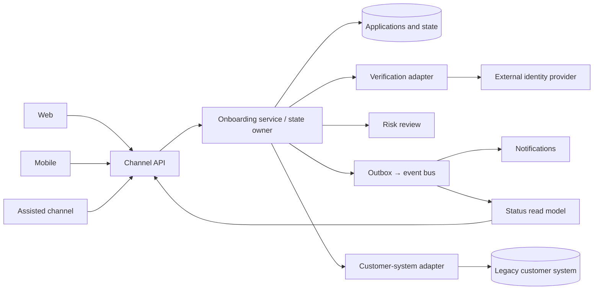
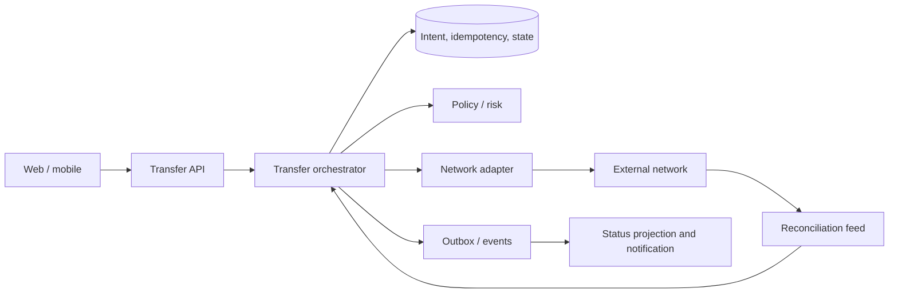

# Sr Solutions Architect I: solution design interview guide

**Purpose:** Practice the interview in which you receive an unfamiliar business use case and must design a defensible
system in real time. This guide is based on the responsibilities and qualifications in the supplied posting. All cases
below are **fictional practice prompts**, not claims about the employer's systems or your experience.

## 1. What this posting is really testing

| Posting signal                                        | Show it in your design answer                                                                                                           |
|-------------------------------------------------------|-----------------------------------------------------------------------------------------------------------------------------------------|
| Align solutions with platform blueprints and roadmaps | Identify existing platforms, reuse or extension points, and a phased target architecture. Say where you need to confirm the blueprint.  |
| Optimize cross-platform integration and performance   | Define ownership and contracts across systems; discuss latency, throughput, backpressure, and failure isolation.                        |
| Own API strategy                                      | Specify consumers, resource or command semantics, authorization, versioning, errors, idempotency, lifecycle, and operational ownership. |
| Work with business and data architects                | Translate business outcomes into capabilities; name the system of record, data definitions, quality rules, and retention needs.         |
| Lead governance and reviews                           | Compare options against decision criteria; record decisions, risks, tests, rollout gates, and exceptions.                               |
| Remain hands-on                                       | Explain one endpoint, state transition, schema, or code-review concern in concrete detail.                                              |
| Use AI-assisted architecture responsibly              | Show where AI speeds analysis or documentation, what data is allowed, and how humans verify its output.                                 |

**The senior-level difference:** Do not stop at a box diagram. Explain *why* each boundary exists, what happens when a
dependency fails, who owns each decision, and how you will deliver the design without disrupting existing users.

## 2. Your 30-minute interview playbook

| Time      | Action               | What to say or draw                                                                                                                                            |
|-----------|----------------------|----------------------------------------------------------------------------------------------------------------------------------------------------------------|
| 0–3 min   | Frame the problem    | “Let me confirm the user journey, business outcome, and what is out of scope.”                                                                                 |
| 3–6 min   | Clarify constraints  | Ask about volume, response time, availability, security, existing systems, data ownership, and rollout deadline. State assumptions if answers are unavailable. |
| 6–10 min  | Draw the context     | Users/channels → API boundary → domain services → systems of record/external parties; mark synchronous and asynchronous paths.                                 |
| 10–17 min | Walk one transaction | Give the happy path, state model, API contract, and data ownership. Explain your most consequential choice.                                                    |
| 17–23 min | Break the design     | Handle duplicate requests, lost responses, downstream slowness, partial failure, stale data, and recovery.                                                     |
| 23–27 min | Operate and deliver  | Cover SLOs, telemetry, security, capacity, migration, tests, and rollout.                                                                                      |
| 27–30 min | Summarize tradeoffs  | “I chose A over B because of constraint X. The remaining risk is Y; I would validate it with Z.”                                                               |

### Ask these questions first

1. **Outcome:** Who is the user, what action must work, and what business measure defines success?
2. **Scope:** Which channels, regions, products, partners, and existing systems are involved? What is explicitly
   excluded?
3. **Truth:** Which system owns each business decision and data field? What is the authoritative final state?
4. **Quality:** Peak traffic, latency, availability, recovery time, recovery point, freshness, retention, and regulatory
   constraints?
5. **Change:** Must we preserve current consumers? Is this a new capability, migration, or both? What is the release
   horizon?

If the interviewer gives no numbers, say: **“I will use illustrative assumptions so I can show the design. I would
replace them with measured traffic and agreed SLOs before implementation.”**

### Draw in this order

```text
Actors/channels → edge/API → domain owner → authoritative store/system → external dependencies
                         ↘ events/queue → secondary consumers

Across every boundary: identity, authorization, contract, timeout, correlation ID
Under every box: owner, state/data it owns, scaling or recovery concern
```

**Narration template:** “The customer starts at ___. The ___ service owns the operation and writes ___ before
calling ___. The source of truth for ___ is ___. We return ___ immediately and update ___ later. If ___ fails, we ___. I
chose this boundary because ___.”

## 3. Design decisions you should be ready to defend

| Decision                 | Choose this when                                                                      | Watch for / justify                                                                                                 |
|--------------------------|---------------------------------------------------------------------------------------|---------------------------------------------------------------------------------------------------------------------|
| Synchronous API          | Caller needs an immediate decision or authoritative read.                             | Set a latency budget and timeout; avoid chains of many blocking calls.                                              |
| Queue or event           | Work can complete later, or several consumers react to a committed state change.      | Define delivery semantics, ordering scope, retries, poison messages, replay, and consumer idempotency.              |
| REST resource            | Consumers need standard create/read/update operations on a well-owned resource.       | Make status and error semantics clear; do not expose internal tables as the API.                                    |
| Explicit command API     | Action has business validation or a state transition, such as `submitPayment`.        | Distinguish accepted from completed; support idempotency for retried commands.                                      |
| One domain service       | One business capability and data owner can evolve together.                           | Avoid a giant shared service that becomes a coordination bottleneck.                                                |
| Separate services        | Different capabilities, owners, scaling needs, or release cadences justify the split. | A distributed transaction and more operations work are the cost. Do not split just to draw more boxes.              |
| Relational store         | Transactions, constraints, and consistent updates matter.                             | Evaluate hot spots, read scaling, retention, and recovery.                                                          |
| Cache/read model         | Repeated reads can tolerate defined staleness.                                        | State the freshness limit, invalidation rule, and fallback; never let a cache become an accidental source of truth. |
| Orchestration            | A business process has a clear owner and several steps or compensations.              | Persist the workflow state; avoid a fragile in-memory sequence.                                                     |
| Choreography             | Independent consumers react to facts without one central process owner.               | Watch hidden dependencies, event coupling, and hard-to-trace end-to-end flow.                                       |
| API facade around legacy | Consumers need a stable contract while the implementation changes.                    | The facade must not simply reproduce legacy data leakage or become a permanent bottleneck.                          |

**Three rules that prevent common mistakes**

- Network delivery is not “exactly once.” Use durable state, idempotent operations, reconciliation, and clear semantics.
- A timeout does not tell you whether a remote action succeeded. Treat the outcome as **unknown** until verified.
- Eventual consistency is acceptable only when you say which views may lag, by how much, and what users see meanwhile.

## 4. Fully worked case: unified business-customer onboarding

**Prompt:** A company wants businesses to onboard through web, mobile, and an employee-assisted channel. Identity
verification and risk checks rely on third-party providers. The existing customer system is the system of record.
Customers should see one consistent application status across channels.

### Clarify

- Can an applicant save a draft and resume in another channel? What identity links those sessions?
- Which decisions are immediate, and which may take hours or days? Is a manual review possible?
- Does the legacy customer system accept provisional records, or only approved customers?
- What personal data and documents are collected? Who may view them, and for how long?
- What is the peak application rate and the acceptable time to acknowledge a submission?

### Candidate design



**Ownership:** The onboarding service owns the application, its workflow, and the status visible to channels. The
existing customer system owns the approved customer record. Verification and risk services own their decisions.
Documents go to controlled object storage with references in the application record; do not copy raw documents into
events.

**State model:** `DRAFT → SUBMITTED → VERIFYING → (MANUAL_REVIEW | APPROVED | DECLINED) → CUSTOMER_CREATED`. Define an
explicit `ACTION_REQUIRED` state for missing documents and a recoverable `CREATION_PENDING` state if approval succeeds
but legacy creation is delayed. Do not show `COMPLETE` until the authoritative customer record exists.

**API example:** `POST /applications` creates a draft; `PATCH /applications/{id}` saves allowed fields;
`POST /applications/{id}/submit` is a command with an idempotency key; `GET /applications/{id}` returns status, required
next action, and a version/updated timestamp. Authorization must check the applicant or authorized employee against that
specific application, not just authenticate the caller.

### Choices and justification

| Choice                               | Why                                                                                           | Alternative and when it wins                                                                            |
|--------------------------------------|-----------------------------------------------------------------------------------------------|---------------------------------------------------------------------------------------------------------|
| Shared workflow service              | One set of rules and status across three channels; channel teams can tailor presentation.     | Channel-owned workflows work only if processes genuinely differ and consistency requirements are loose. |
| Asynchronous verification            | Provider latency and manual review should not hold an HTTP request open.                      | Synchronous check is fine for a fast, required precheck with a bounded timeout.                         |
| Adapter for legacy customer creation | Isolates the legacy contract and supports later migration.                                    | Direct call is simpler if the legacy API is already stable, well-owned, and meets the contract.         |
| Durable outbox after state changes   | Avoids publishing an event for a change that did not commit, or losing an event after commit. | A platform-supported transactional event mechanism can serve the same purpose.                          |
| Status endpoint plus optional push   | Customers can always refresh an authoritative status; push improves experience.               | Push alone is insufficient because delivery can be missed.                                              |

**Failure walk-through:** If the verification provider times out, persist `VERIFYING`, retry within a budget, then route
to manual review or alert; do not create a second application. If the legacy system times out after approval, check by
stable application reference before trying again. If a notification fails, onboarding state remains correct and the
event is retried independently.

**Security and operations:** Encrypt sensitive data, minimize event payloads, restrict employee access by role and
purpose, set retention with legal/compliance owners, and log access without raw documents. Watch submission success,
time in each state, provider error rate, manual-review backlog, legacy creation lag, status freshness, and abandoned
drafts.

**How to close this case aloud:** “I made onboarding the workflow owner because the business needs one state across
channels. I separated the approved customer record because the existing customer platform remains authoritative. The
main tradeoff is a durable workflow and event infrastructure in exchange for recoverable partner failures and consistent
status. I would validate the legacy creation contract and verification latency with a thin end-to-end pilot.”

**Follow-up drills:** What if an applicant submits twice from different devices? What if a verification result arrives
after the customer was manually declined? How do you prove an employee was authorized to view a document? How do you
migrate an existing in-progress application?

## 5. Case: payment or transfer with an uncertain external outcome

**Prompt:** Customers schedule a transfer from web and mobile. An external network may accept a request and then lose
the response. The same customer may retry. Design safe submission and status tracking.

**Invariants:** Never create an unintended duplicate transfer. Never tell the customer that money moved when only
submission was accepted. The ledger or posting system owns the final financial position.



**Sequence:** Validate authorization and limits → atomically create an intent and bind
`(customer, operation, idempotency key)` to the request fingerprint → return one operation ID → submit with a stable
partner reference → record acknowledgement or `OUTCOME_UNKNOWN` → reconcile to a final state. A retry with the same key
and same payload returns the same operation; reuse of a key with different payload is rejected.

**Why this design:** A synchronous API gives the customer an immediate *acceptance* response, while settlement proceeds
asynchronously. The orchestrator owns state transitions; the network adapter isolates partner rules. A lost response
triggers inquiry/reconciliation, not blind resubmission. Use bounded retries only where the partner contract makes them
safe. Events update projections and notifications, but the transfer state and ledger remain the authoritative sources
for their respective facts.

**Probe answers:** For a downstream outage, queue or hold accepted work only if the business permits delayed execution;
apply backpressure and show pending status. For cancellation, define the cutoff before submission and what “cancel”
means after external acceptance. For reversal, model a new compensating transaction and audit trail instead of deleting
history. For release, pilot with limits, reconciliation monitoring, and a kill switch for new submissions.

**Tradeoff sentence:** “I accept more workflow complexity to keep duplicate-transfer risk low and make ambiguous
outcomes recoverable.”

## 6. Case: modernize a legacy capability used by many products

**Prompt:** Six product teams call a legacy account service directly. Its interface is inconsistent and changes slowly.
The business wants new features without a high-risk replacement.

**Design:** Inventory consumers and usage; define a business-owned account API with stable semantics and an owner; put a
facade/adapter in front of the legacy service; route one narrow capability through it; add contract tests, tracing, and
rate controls; then gradually implement selected capabilities behind the same API. Preserve one write authority during
each phase. If migrating data, define reconciliation and cutover criteria before moving writes.

| Choice                           | Justification                                                                      | Risk to address                                                            |
|----------------------------------|------------------------------------------------------------------------------------|----------------------------------------------------------------------------|
| API facade                       | Decouples consumers from legacy internals and creates a controlled migration seam. | Added hop and possible “pass-through” facade with no real domain contract. |
| Consumer migration by capability | Smaller blast radius and measurable progress.                                      | Long coexistence period; track and retire old paths.                       |
| Single write owner per phase     | Avoids divergent dual writes.                                                      | Cutover needs a clear rollback and reconciliation plan.                    |
| Read cache only where justified  | Relieves load on legacy reads.                                                     | Stale account data; state freshness and invalidation explicitly.           |

**What to say about governance:** “I would agree on the API contract and deprecation timeline with product and data
owners, record the target boundary in an architecture decision, and make contract, performance, and security checks part
of each migration release.”

**Follow-up drills:** What if a product team refuses to migrate? What if the facade increases p99 latency? How do you
cut over a write path without dual-writing indefinitely? Which legacy fields should never be exposed?

## 7. Case: shared notifications across products

**Prompt:** Several products send email, SMS, and push notifications. Duplicate, delayed, or out-of-order messages are
causing customer confusion.

**Design:** Product services emit business facts with event IDs and subject IDs. A notification service owns
preferences, templates, channel selection, send attempts, and provider adapters. Persist the notification request and
deduplicate by event plus template/version or a business-defined key. Use queues per priority and channel, bounded
retries, dead-letter handling, and provider callbacks. Keep mandatory legal notices separate from marketing preferences
according to business policy.

**Important tradeoffs:** A shared platform reduces duplicated provider integration, but it can become a noisy-neighbor
bottleneck. Isolate capacity and quotas by product and priority. Event order is usually guaranteed only within a
partition or key; if order matters, partition by customer or aggregate and reject stale versions. A provider “accepted”
receipt is not the same as customer delivery. A fallback channel needs consent and policy checks; it is not an automatic
retry.

**Measures:** enqueue-to-send latency, delivery outcome by provider/channel, duplicate suppression, dead-letter depth,
preference violations, and per-product backlog.

## 8. Case: operational reporting across several systems of record

**Prompt:** Leaders need a dashboard combining orders, customer records, and support cases. Today teams export
spreadsheets and disagree on definitions.

**Design:** Have business and data architects define metrics, identifiers, ownership, lineage, and acceptable freshness
first. Ingest changes through supported APIs, CDC, or batch exports according to each source's capability and
constraints. Land immutable raw records with controlled access; validate and transform them into a governed analytical
model; publish a read-only dashboard or API. Reconcile counts and key business totals against sources, and expose
freshness timestamps and data-quality warnings.

**Choice to defend:** Do not make the operational API serve a cross-domain reporting workload if it will harm
transaction latency. CDC gives lower latency but adds ordering, schema-evolution, and deletion-handling work. Batch is
simpler when daily freshness is enough. A shared customer ID or matching rule is a business decision, not a join you can
invent at the whiteboard.

**Failure probes:** A source changes a field meaning; a pipeline replays yesterday's events; a dashboard number differs
from the system of record; personal data must be deleted. Explain schema contracts, idempotent loads, reconciliation,
lineage, retention, and correction procedures.

## 9. Case: partner API platform and API roadmap

**Prompt:** Multiple internal teams want to expose capabilities to external partners. Existing APIs use inconsistent
authentication, error formats, and release practices.

**Design:** Create a catalog of business capabilities and consumers; define API ownership and lifecycle standards; use
an edge gateway for authentication enforcement, rate limits, and basic telemetry; keep domain authorization and business
rules in the owning service. Publish machine-readable contracts, common error shapes, examples, sandbox behavior, and a
deprecation policy. Roll out one valuable API first, measure adoption and support issues, then migrate others by risk
and value.

**Design review checklist:** Does the API reveal a stable business capability? Who owns each data field? Is
authorization enforced per resource? Are pagination, filtering, idempotency, retries, and throttling documented? Can a
consumer distinguish validation failure, conflict, temporary failure, and unknown outcome? What is the compatibility
promise? Are logs safe and traceable?

**Tradeoff:** Shared gateway standards improve consistency, but a central team should not become the approval bottleneck
for every domain change. Standardize cross-cutting controls and leave domain contracts with accountable product teams.

## 10. Case: AI-assisted architecture review workflow

**Prompt:** The architecture group wants AI tools to speed requirement analysis, API reviews, and documentation. Teams
worry about sensitive data and incorrect recommendations.

**Design:** Start with approved, low-risk uses: summarize sanitized requirements, compare an API contract against a
checklist, draft decision records, and identify unanswered questions. Use an approved tool and a defined data
classification policy. Keep source documents, prompts, generated output, reviewer corrections, and final decisions
traceable. A named architect validates every recommendation against system facts, security requirements, performance
evidence, and platform standards before it becomes a decision. Measure time saved, defect detection, false positives,
and review rework.

**Where AI helps:** It can surface missing cases, inconsistent terminology, and draft alternatives. **Where it cannot be
the authority:** Data ownership, compliance interpretation, production readiness, and approval. Never paste secrets or
restricted customer data into a tool without explicit policy approval. If the model suggests a product or capability,
verify it against current approved platform documentation.

**Interview answer:** “I would introduce AI as a review assistant with an evidence trail, clear allowed data, and human
sign-off. I would start with one repeatable review checklist, compare output against senior architect reviews, then
expand only where quality improves.”

## 11. A quick sizing example

Suppose the interviewer says an API receives **2 million requests/day**, with a **20× peak-to-average** burst. Average
is about `2,000,000 / 86,400 ≈ 23 requests/second`; estimated peak is about `460 requests/second`. With **3× capacity
headroom**, design and load-test for roughly `1,400 requests/second` at the edge. Then ask how many requests cause
downstream writes, what the payload size is, and whether peak is sustained or brief. The arithmetic is a starting point;
measure actual traffic distribution before setting capacity.

For latency, allocate a budget: if the user-facing p95 target is 500 ms, reserve time for network/edge, your service,
and downstream calls. If a partner's p95 alone exceeds the budget, move that work to an asynchronous flow and return a
truthful pending state.

## 12. How to handle interviewer changes

| New constraint                       | Adaptation to explain                                                                                                                                       |
|--------------------------------------|-------------------------------------------------------------------------------------------------------------------------------------------------------------|
| “Traffic grows 10×.”                 | Recalculate bottlenecks; separate read/write scaling, add backpressure, test dependency quotas, and preserve correctness.                                   |
| “The partner is down for two hours.” | Decide whether to reject, queue, or hold work based on business semantics; show status, expiry, alerts, and recovery procedure.                             |
| “No new database allowed.”           | Re-evaluate state ownership using approved stores; explain what guarantees are lost and what must be validated.                                             |
| “Must launch in six weeks.”          | Deliver a thin vertical slice with existing platforms, explicit scope, telemetry, and rollback; defer optional channels or features.                        |
| “Two teams disagree on ownership.”   | Map business capability and source of truth; compare alternatives on change cadence, consistency, and operations; record the decision and escalation owner. |
| “AI should design it for us.”        | Use AI to generate options and questions, then verify contracts, assumptions, risks, and compliance with accountable humans.                                |

**Good sentence when challenged:** “That changes my earlier assumption. I would revise ___ because ___; the rest of the
design can stay if ___ remains true.”

## 13. What to put in an architecture decision record

```text
Title and date:
Business outcome and scope:
Existing platform/blueprint constraints:
Decision and owner:
Options considered:
Decision criteria (correctness, security, latency, cost, delivery, operations):
Why this option won:
Consequences and residual risks:
Validation needed (spike, load test, threat model, contract test):
Migration, rollback, and review date:
```

In the interview, a short version is enough: **“We chose X because the strongest constraints were A and B. Y was simpler
but failed C. We will validate D before rollout and revisit when E changes.”**

## 14. Practice schedule and self-score

Practice each case **twice**: once in 25 minutes at a whiteboard, then once in 8 minutes as an executive summary. On the
second pass, have a friend interrupt with one new constraint from section 12.

| Area                | 1 = missing            | 3 = adequate                   | 5 = strong                                                          |
|---------------------|------------------------|--------------------------------|---------------------------------------------------------------------|
| Business framing    | Jumps to technology    | Asks basic requirements        | Defines outcome, invariant, and scope                               |
| Boundaries/data     | Unclear owners         | Main components named          | Every key state and field has an owner                              |
| Contracts           | Vague “API” arrows     | Endpoint/event shape described | Semantics, authorization, errors, versions, idempotency covered     |
| Failure handling    | Happy path only        | Retries and alerts mentioned   | Ambiguous outcomes, recovery, reconciliation, user status explained |
| Quality attributes  | Says “scalable”        | Names latency/security         | Uses budgets, capacity assumptions, SLOs, and evidence              |
| Tradeoffs           | One unexplained choice | Mentions an alternative        | Compares viable options against constraints                         |
| Delivery/leadership | “Build it”             | Phased rollout                 | Governance, teams, tests, migration, rollback, measures             |

**Target:** Score at least 4 in each area. Rehearse the *lowest* area, not the whole interview again.

## 15. Your final two-minute answer structure

> “The business outcome is **[outcome]**, and the critical invariant is **[thing that must never go wrong]**. I assume
> **[scale and constraints]** until we confirm them. **[Service]** owns **[workflow/state]**, while **[system of record]**
> remains authoritative for **[data]**. The channel calls **[API]**; longer work moves through **[queue/event]**. I chose
> this because **[constraint]**; the main alternative was **[alternative]**, which would make **[tradeoff]** harder. For
> failure, **[duplicate/timeout/partial outage]** results in **[safe state and recovery]**. I would prove the design with
> **[contract/performance/security tests]**, launch through **[phased approach]**, and measure
> **[business and technical outcomes]**.”

Do not memorize the nouns. Memorize the order: **outcome → invariant → assumptions → ownership → flow → tradeoff →
failure → validation and rollout**.

---

**Source:** User-supplied `job_posting_resp.txt` for Sr Solutions Architect I. The posting contains role requirements;
it does not specify a technology stack, employer architecture, interview format, or evaluation rubric. The scenarios and
numbers here are practice assumptions.
