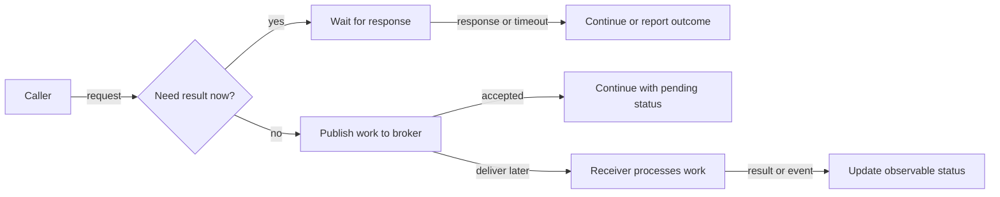
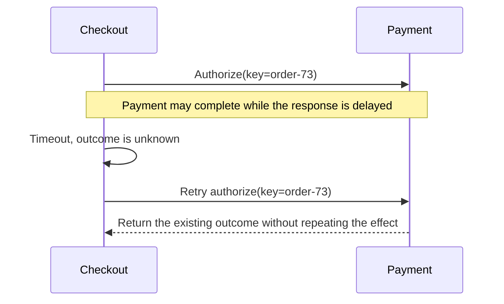
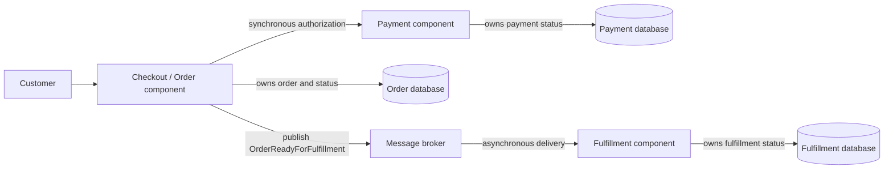

# Distributed Application Design

**Core learning guide for Solution Architect interviews**

This guide explains how to divide an application into components, define their responsibilities, choose how they
communicate, and reason about the failures that occur between them. It starts with a simple mental model and builds
toward the tradeoffs an architect should be able to defend.

## Learning outcomes

After studying this guide, you should be able to:

- Trace a request through a distributed application and identify component responsibilities.
- Explain the difference between a logical component boundary and a separately deployed service.
- Describe data ownership and choose between synchronous and asynchronous communication.
- Compare a monolith, modular monolith, and microservices using business and operational constraints.
- Identify common cross-component failure modes and explain proportionate controls.
- Present a design decision with its rationale, tradeoffs, assumptions, and validation plan.

The key idea is that an application is a set of responsibilities that work together to deliver a business outcome.

## 1. Start with the system, not the service count

A **distributed application** uses multiple components that communicate across process or network boundaries to
complete a capability.

A component might be a function, module, application process, managed platform service, or external system.

Not every component is a microservice, and not every useful architecture needs many components.

Consider a customer placing an order:

```text
Customer -> Checkout -> Order record -> Payment -> Confirmation
```

This is a business flow, not yet an architecture. To design the system, ask four questions:

1. **Responsibility:** What work does each component perform?
2. **Ownership:** Which component is authoritative for each business fact or data set?
3. **Communication:** How does one component ask another to act or learn that something happened?
4. **Failure:** What does the customer and the business see if a component or network connection fails?

An architecture becomes understandable when these answers are explicit. A box-and-arrow diagram alone is not enough:
the boxes need named responsibilities, and the arrows need a meaning.

**Component boundary:**

> A boundary marks which responsibility belongs to a component and which decisions it can make without coordinating
> with another component.

**Data owner:**

> The data owner is the component accountable for creating, validating, and changing a business fact.
> Other components should use an agreed interface rather than silently changing that owner's data.

For example, the Order component can own order status, while a Payment component owns payment authorization and
settlement status. An order may refer to a payment identifier, but that does not make the Order component authoritative
for payment records.

## 2. Separate logical design from deployment

A **logical component** is a responsibility boundary in the design.

A **deployment unit** is something built, released, and operated independently.

The two concepts are related, but they are not the same.

A **monolith** is a single deployable application without clear internal boundaries. It can be a single module or a
large codebase with many responsibilities. It is not inherently bad, but it can make ownership, scaling, and independent
delivery harder.

A **modular monolith** is a single application with clear internal modules, each with a defined interface and owner:
one deployable application with deliberate internal boundaries.

> Here, an **owner** is the component that is the authoritative source for a particular kind of data and is responsible
> for changing it and enforcing its rules.
>
> **“Owner”** means a software component, not necessarily a person or a separately deployed service. A module inside a
> modular monolith can own data just as a microservice can.
>
> **Examples:**
> **Shopping cart:** The Cart component owns cart contents and quantities. A Checkout component can read the cart and
> request changes through the Cart interface, but shouldn’t directly edit cart records.
>
> **Customer profile:** The Customer component owns a customer’s name and contact details. An Order component can store
> the customer ID and use the profile, but the Customer component remains responsible for updating the details.


A **microservice** is a separately deployable service, usually aligned to a cohesive business capability and operated as
an independent process.

A distributed application can be a mix of monoliths, modular monoliths, and microservices. The choice depends on the
business needs, team structure, and operational constraints.

```text
Modular monolith                         Distributed services
┌────────────────────────┐               ┌───────────┐   ┌───────────┐
│ One application        │               │ Order     │-->| Payment   │
│ ┌──────┐  ┌─────────┐  │               │ service   │   │ service   │
│ │Order │->│ Payment │  │               └─────┬─────┘   └───────────┘
│ └──────┘  └─────────┘  │                     │ network
└────────────┬───────────┘               ┌─────v─────┐
             v                           │ Inventory │
       Shared process                    │ service   │
                                         └───────────┘
```

The diagram contrasts deployment shape, not quality. Either design can have good or poor boundaries. Separate
deployments introduce network calls, independent releases, service monitoring, access controls, and failure handling.
They can also support independent scaling and delivery when those capabilities are valuable.

**Monolith:**

> Useful when the domain or team is small, or fast delivery with one operational unit is the priority. Internal
> boundaries can erode, and one release and scaling unit may become limiting.

**Modular monolith:**

> Useful when the application needs clear domain boundaries, ownership but independent deployment is not yet worth the
> operational cost. Modules still share a process and often a release, so discipline is needed to prevent unwanted
> coupling.

**Microservices:**

> Useful when capabilities have clear ownership and meaningful needs for independent delivery, scale, or fault
> isolation. Network failures, data coordination, observability, deployment, and on-call complexity increase.

These are options, not a maturity ladder. A senior architect does not recommend microservices merely because the system
is expected to grow. First establish which constraint requires independent deployment or operations.

**Decision test:**

> Split a component when
>
> the **benefit** of `independent change`, `scaling`, `ownership`, or `fault isolation`
>
> **is greater than** the **cost of** `operating and coordinating across a network boundary`.

Useful evidence includes `different change rates`, `materially different scaling needs`, `distinct business 
capabilities`, `separate team ownership`, or a `need to contain specific failures`.

"The code is large" or "microservices are modern" is not enough by itself.

**Need to contain specific failures**: Design a boundary so a failure in one capability has limited impact on the
rest of the system.

> Example scenarios that might justify a separate service:
> - **Payment provider outage:** Payment processing can fail or become delayed without bringing down browsing or cart
    management. Customers might not be able to complete checkout, but they can still use the rest of the site.
>
>
> - **Recommendation service failure:** Recommendations can time-out or go offline without preventing customers from
    searching for or buying products.

## 3. Draw boundaries around capabilities and data

A **business capability** is something the organization must be able to do, such as accept an order, authorize a
payment, or fulfill a shipment.

A service boundary should normally **group** `work and data that change together`, and **separate** `work that has 
different ownership or reasons to change`.

For a simple ordering example:

```text
Checkout / Order                    Payment                    Fulfillment
-----------------                   -------                    -----------
Accept order                        Authorize payment          Allocate stock
Track order status                  Capture/refund             Prepare shipment
Own order data                      Own payment data           Own fulfillment data
```

These are candidate boundaries, not a required three-service design.

An early system might implement them as modules in one deployable application. The same responsibilities can later be
separated if there is evidence that independent deployment is valuable.

**Data ownership rule of thumb:**

> A component may keep a local copy of another component's data for speed or availability, but the copy is not the
> authoritative source. Define how it is refreshed and how stale it may be.

Avoid casual shared-database writes across services. If several services directly change the same tables, their
deployments and data model are coupled even if their code is in separate repositories.

During a migration, shared storage may be a deliberate temporary state; record the risks, ownership, and exit plan
rather than treating it as a clean target.

Before splitting a capability, check:

- **Cohesion:** Do the responsibilities belong together and change for similar reasons?
- **Ownership:** Is there a clear team or component accountable for the business rules and data?
- **Contract:** Can other components use it through a stable, understandable interface?
- **Quality needs:** Is there a real difference in scale, latency, availability, security, or deployment needs?
- **Operations:** Can the organization deploy, monitor, secure, and support another production service?

## 4. Choose how components communicate

Two common communication styles are **synchronous** and **asynchronous**.

**Synchronous communication:**

> The caller sends a request and waits for a response before continuing. A REST API call is a common example.

```text
Checkout -- request: authorize payment --> Payment
Checkout <-- response: approved/declined -- Payment
```

This is useful when the caller needs an immediate result to make the next decision. It is easy to understand in a
request flow, but the caller depends on the network and the responding component being available within the timeout.

**Asynchronous communication:**

> The sender records or publishes work and continues without waiting for the receiver to finish. A queue or event
> broker is one way to do this.

```text
Order -- publish: OrderAccepted --> Broker -- deliver later --> Fulfillment
```

This is useful when work can finish later, the receiver may be temporarily unavailable, or a burst should be buffered.
It adds message storage, delivery behavior, monitoring, and recovery responsibilities. A broker does not remove
dependencies; it changes when and how they are experienced.

The diagram compares the point at which the sender continues. The synchronous path waits for the receiver's response;
the asynchronous path hands work to a broker and continues before the receiver finishes.



**Synchronous request:**

> Use it when the caller usually needs a result now. Design the contract, timeout, retry policy, and caller behavior.
> Failure may appear as a timeout, error response, or unavailable dependency. Long call chains can create cascading
> latency or outages.

**Asynchronous message:**

> Use it when work can finish later. Design the message contract, acknowledgement, duplicate handling, ordering,
> retention, and replay. Failure may appear as delayed work, redelivery, a growing backlog, or a failed message.
> Debugging end-to-end status and handling eventual consistency can be harder.

Use the business interaction to choose, not a rule that all communication should be asynchronous. For example, the
customer may need a quick response that an order was received, while shipment preparation can happen asynchronously.
The response should be truthful: “accepted for processing” is not the same as “fully shipped.”

## 5. Treat network boundaries as failure boundaries

Inside one function call, a result may be available immediately. Across a network, a request can be delayed, lost, or
answered after the caller times out. A timeout does not necessarily mean the receiver did no work.

Suppose Checkout sends a payment authorization request. Payment processes it, but the response is delayed. Checkout
times out. If Checkout retries without a stable operation identifier, the customer could be authorized twice.

The sequence shows why a timeout means “outcome unknown,” not necessarily “the operation failed.”



The same business operation identifier lets Payment recognize the retry and return the known outcome rather than
performing the operation again. This behavior is **idempotency**: repeating a request with the same key has the same
business effect as performing it once.

**Important controls, chosen according to risk:**

- **Timeout:** Bound how long a caller waits. Set it with the end-to-end latency objective and downstream behavior in
  mind.
- **Retry:** Retry only failures likely to be temporary, within a bounded attempt or time budget. Use backoff and
  jitter so many callers do not retry in lockstep.
- **Idempotency:** Use a stable business operation key where duplicate requests or deliveries could cause harmful
  repeated effects.
- **Circuit breaker:** Temporarily stop calls to a dependency that is repeatedly failing, allowing the system to fail
  quickly and giving the dependency room to recover.
- **Bulkhead:** Limit the resources or concurrency used by one dependency so its failure does not consume all capacity.
- **Graceful degradation:** Offer a reduced but honest capability when a non-essential dependency is unavailable.

Retries are not a general repair for failure. Retrying a permanent validation error wastes capacity. Retrying a
non-idempotent operation can create duplicates. A distributed design should state how it behaves when the result is
unknown.

**Availability intuition:**

> If a request requires every dependency in a chain to respond, the chain is less available than any one dependency.
> This is why architects minimize unnecessary calls on critical paths and define what can be delayed or degraded.

For illustration only, if three required dependencies each have 99% availability and failures are independent, the
chance all three are available is `0.99 × 0.99 × 0.99`, or about 97%. Real failures are not always independent, so use
this as an intuition rather than a production availability prediction.

## 6. Understand consistency across components

When one business action updates data owned by multiple components, the system must define what “complete” means.
The components may not share one database transaction.

Consider order acceptance and inventory reservation. The diagram shows one possible compensation if the reservation
cannot be completed; an actual workflow must choose actions that match its business rules.

```text
Order service             Inventory service
     |                            |
     | reserve(order-73)          |
     |--------------------------->|
     |                            | reserve stock
     |<---------------------------|
     | reservation confirmed     |
     |                            |
     | if reservation fails:     |
     | cancel order / review      |
```

For a short period, the Order component may show “pending inventory” while Inventory is still processing the request.
This is **eventual consistency**: different views can temporarily disagree, with an expectation that they converge if
processing succeeds. It is suitable only when the business can tolerate the delay and the design includes status,
recovery, and customer communication.

If a later step fails, the system needs a business response: retry, cancel the order, release a reservation, or route
the case for review. A **Saga** is a sequence of local transactions with explicit follow-up or compensating actions;
it is not a single atomic database transaction, and a compensation may not perfectly undo an action that has already
happened.

Start with the invariant:

> What must never be false, and how long can the system tolerate an incomplete or stale view?

For example, “never charge twice” is a stronger invariant than “the order screen updates within a few seconds.”
Preserve strong consistency for the specific data and action that require it; do not make every interaction synchronous
by default. Use idempotency, explicit states, reconciliation, and operational review where they fit the business risk.

## 7. Worked example: accept an order and start fulfillment

The following is a starting design for an online retailer. It is deliberately small; actual requirements could change
the choices.

**Assumptions:** The customer needs prompt confirmation that the order was received. Payment authorization must be
known before fulfillment starts. Shipment preparation can happen later. Temporary delays are acceptable if the customer
can see a truthful status. The example does not assume any particular provider, traffic volume, or regulatory regime.



### Request flow

1. Checkout validates the request and creates an order with a stable order identifier.
2. Checkout requests payment authorization using an idempotency key derived from the order and operation.
3. If authorization succeeds, the Order component records the state and makes fulfillment work available.
4. Fulfillment receives the work, checks whether it has already processed that order, and records its result.
5. The Order component or a status view is updated so the customer can see progress.

The important distinction is between a confirmed business outcome and an uncertain network outcome. If Checkout times
out after requesting payment, it should not blindly create a second charge. It should retry with the same key or query
the payment outcome, according to the Payment interface.

### Decisions to defend

**Why keep Order and Payment separate?**

> Separate ownership can make sense if payment rules, security controls, team responsibility, or change patterns are
> distinct. If this is a small system without such a need, they may start as well-defined modules in one application.

**Why synchronous payment authorization?**

> Under the stated assumption, fulfillment must not start until authorization is known. The synchronous call provides
> that decision point, but it needs a timeout, idempotency, and a clear “outcome unknown” path. If the business accepts
> pending authorization, an asynchronous flow could reduce checkout dependency but would change the customer experience.

**Why asynchronous fulfillment?**

> Shipment preparation can happen after the customer receives an order acknowledgement. A queue can absorb a temporary
> fulfillment outage, but backlog age and recovery must be monitored.

**Why not split every component into a service immediately?**

> Independent deployment is valuable only if it solves a real ownership, scaling, or delivery problem. Otherwise the
> network and operational costs can outweigh the benefit.

### Failure check

**Payment times out:**

> Treat the result as unknown; retry or query with the same operation key. Do not start fulfillment until the required
> authorization state is confirmed.

**Fulfillment is unavailable:**

> Keep eligible work pending within a defined backlog and age limit. Alert before the customer or business impact
> becomes unacceptable.

**A fulfillment message is delivered twice:**

> Deduplicate by stable order/work identifier or make the business action idempotent.

**Order data is saved but the message is not published:**

> Use a reliable handoff, such as an outbox pattern, or another documented mechanism so the order does not remain
> silently stranded.

**A dependency stays unavailable:**

> Stop harmful retry pressure, communicate an honest status, and provide recovery or manual handling.

These answers are not implementation details to assume universally. They are questions the design must resolve against
business requirements and the selected platforms.

## 8. A repeatable architecture decision method

Use this sequence for a new design or a system redesign:

1. **Establish the outcome.** Identify users, business capability, critical journey, and what success means.
2. **State constraints and quality targets.** Make latency, throughput, availability, recovery, security, cost, and
   delivery constraints measurable where possible.
3. **Map responsibilities and data.** Name capabilities, authoritative data owners, and external dependencies.
4. **Choose the simplest viable boundaries.** Decide which components can remain together and where independent
   deployment or operation is justified.
5. **Choose interaction styles.** Decide which calls need an immediate result and which work can be delayed.
6. **Walk through failures.** Include timeouts, duplicate work, partial completion, dependency outage, and recovery.
7. **Cover operation and evolution.** Define monitoring, support ownership, rollout, rollback, migration, and the
   conditions that would trigger a future boundary change.
8. **Record the decision.** Capture context, decision, alternatives, consequences, assumptions, and validation plan in
   an Architecture Decision Record (ADR) or the team's equivalent.

When defending a choice, state both what it improves and what it makes harder. An architect's recommendation is
stronger when it names the conditions under which it should be revisited.

**Decision statement:**

> Given **[business need and constraints]**, I recommend **[approach]** because it improves **[specific outcome]**.
> The main tradeoff is **[cost or risk]**. I would manage it by **[control]** and revisit the choice if **[measurable
> condition changes]**.

## 9. Interview phrasing

Use this structure for a concise answer:

1. State the business capability and the critical flow.
2. Name the main component responsibilities and data owners.
3. Explain why communication is synchronous or asynchronous at each important boundary.
4. Identify the largest failure risk and how the design contains or recovers from it.
5. Compare the chosen design with a simpler or more independent alternative.

**Interview phrasing:**

> “I would begin with the business flow and its service and data ownership, rather than choosing a number of services
> up front. I would keep responsibilities together unless independent scaling, ownership, or delivery justifies a
> boundary. For each network interaction, I would define the contract, timeout, duplicate behavior, and recovery path.
> I would validate the design against the required service levels and operational capacity, and revisit the boundary
> if those requirements or team ownership change.”

This is a reusable framing, not a claim about a project you personally delivered. For a behavioral question, replace
the illustrative design with your own verified experience.

## 10. Practice and self-check

### Exercise A: Draw the boundaries

Choose a familiar business capability, such as appointment scheduling, travel booking, or order fulfillment. Draw the
customer-facing flow and label:

- Each component's responsibility.
- The authoritative owner of each key business fact.
- Which interactions need immediate responses.
- Which work could be delayed safely.
- One failure that changes what the customer sees.

Start with the fewest components that can express the responsibilities. Add a deployment boundary only when you can
explain its benefit and operating cost.

### Exercise B: Defend the split

Explain why you would choose a monolith, modular monolith, or multiple services for the example. Include one reason
you might reject your preferred option. Do not use team size or future scale as a vague claim; state the specific
capability or constraint those factors affect.

### Exercise C: Explain it aloud

In your own words, answer:

1. What makes an application distributed?
2. Why is a component boundary not automatically a microservice?
3. What is the authoritative owner of a business fact, and why does that matter?
4. When would you use a synchronous call instead of a message?
5. Why can a timeout leave the caller unsure whether a business action happened?
6. What tradeoff do you accept when you add a separate service?

### Check your reasoning

A sound explanation should make these points clear:

- Boundaries follow responsibilities and ownership, not fashion.
- Separate deployments can improve independence, but increase coordination and operating costs.
- Network calls have latency and failure modes that local calls do not.
- Retries can duplicate effects; define bounded retry behavior and idempotency where needed.
- Asynchronous processing changes timing and consistency; it does not eliminate dependency or recovery work.
- Every significant decision is tied to a business outcome, a tradeoff, and evidence that can validate it.

## References

- [Azure Architecture Center: Architecture styles](https://learn.microsoft.com/en-us/azure/architecture/guide/architecture-styles)
- [Azure Architecture Center: Microservices architecture style](https://learn.microsoft.com/en-us/azure/architecture/guide/architecture-styles/microservices)
- [Azure Architecture Center: Design patterns](https://learn.microsoft.com/en-us/azure/architecture/patterns/)
- [AWS Well-Architected Framework pillars](https://docs.aws.amazon.com/wellarchitected/latest/framework/the-pillars-of-the-framework.html)
- [Google Cloud Architecture Framework](https://docs.cloud.google.com/architecture/framework)

Use provider guidance as a source of design considerations, not as a substitute for requirements or architecture
judgment. Verify service-specific guarantees, limits, and operating procedures for the platform selected.
